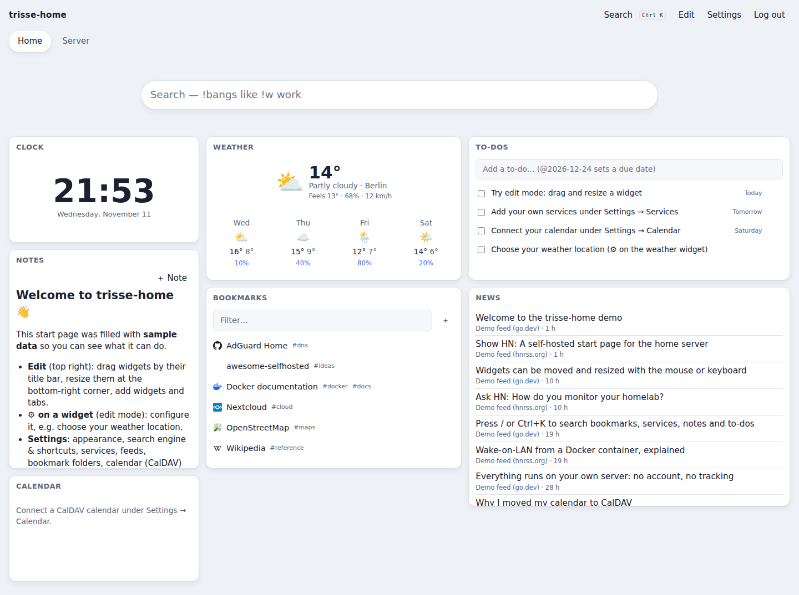
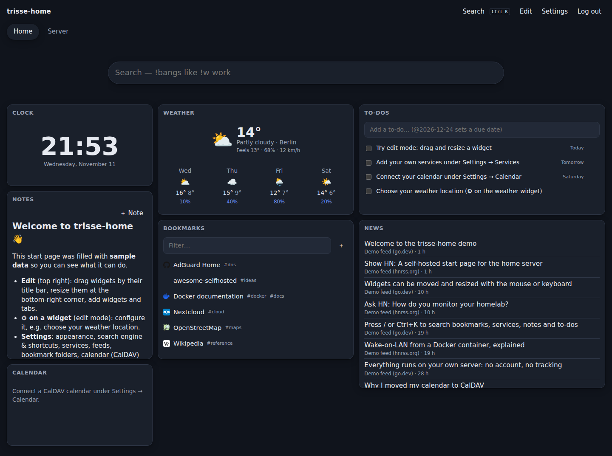
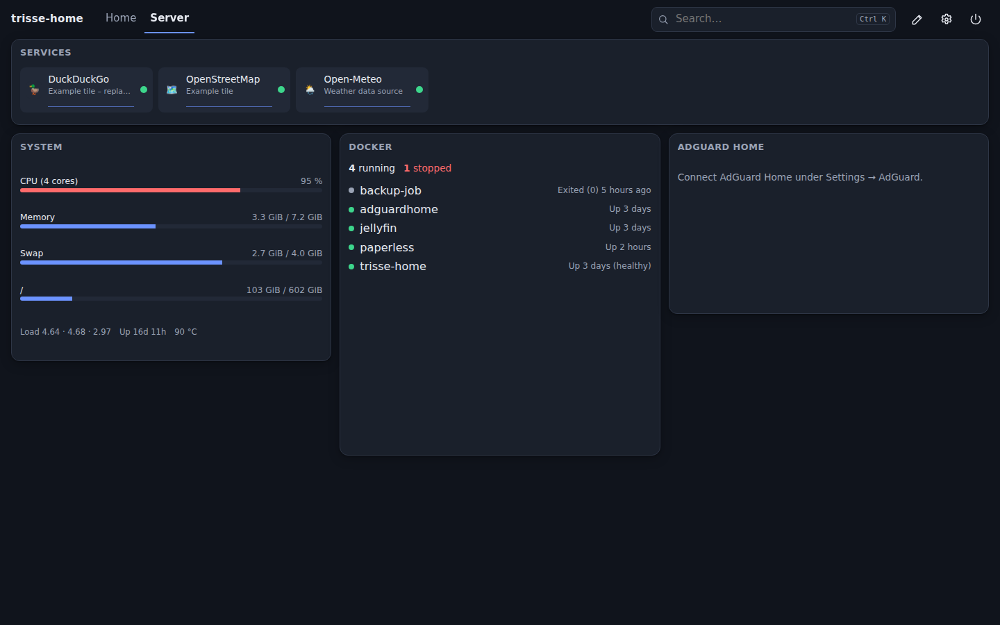
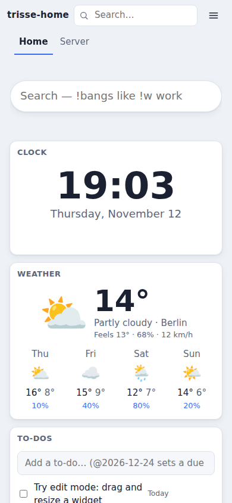
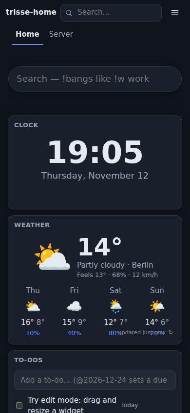

# trisse-home

[](https://github.com/itadori26/trisse-home/actions/workflows/ci.yml)

A self-hosted personal start page in the spirit of iGoogle: freely arranged
widgets on multiple tabs plus small modules for everyday life and the home
server — as lean as possible, as much as necessary, built on a strict Clean
Architecture.

- **One binary, one container (~8 MB image, ~75 MB RAM idle):** Go backend with
  the Svelte frontend embedded; SQLite as database. Node is only needed to
  build. Size and memory are budgets enforced in CI
  ([lean by default](docs/adr/0011-lean-by-default.md)).
- **Private by default:** single-user login, IP allowlist, no telemetry, no
  external requests except to the services you configure.
- **Modular:** every feature is a module that can be switched off.



<details>
<summary>More screenshots (dark mode, server tab, mobile)</summary>

| Dark mode                                                        | Server tab                                                                                       |
| ---------------------------------------------------------------- | ------------------------------------------------------------------------------------------------ |
|  |  |

| Mobile (light)                                                  | Mobile (dark)                                                 |
| --------------------------------------------------------------- | ------------------------------------------------------------- |
|  |  |

The screenshots are generated from a demo instance (`npm run screenshots`,
see [docs/demo.md](docs/demo.md)) and refreshed with every release.
</details>

Not sure whether trisse-home is the right fit? See the
[honest comparison with Homarr, Homepage, Glance and Dashy](docs/comparison.md).

## Features

| Module            | What it does                                                                                                                                                                                                                                                                                                                                                                                                                                                                                                                                                                                                                                                          |
| ----------------- | --------------------------------------------------------------------------------------------------------------------------------------------------------------------------------------------------------------------------------------------------------------------------------------------------------------------------------------------------------------------------------------------------------------------------------------------------------------------------------------------------------------------------------------------------------------------------------------------------------------------------------------------------------------------- |
| **dashboard**     | Tabs with a 12-column drag & drop grid (also keyboard-operable), duplicate widgets, tab templates, per-tab backgrounds, a separate phone layout per tab (order, height, hide on phones) and rules that open a tab by default (weekdays, time of day, client network)                                                                                                                                                                                                                                                                                                                                                                                                  |
| **search**        | Search field next to the greeting (opens the quick search, Ctrl+K or `/`) with DuckDuckGo as default (all `!bangs` work), other engines, custom shortcuts, OpenSearch, quick capture (`t Milch kaufen`, prefixes and "open in a new tab" under Settings → Search); **smart answers** in the quick search: CPU, memory, disks, load, uptime, containers (status, update hint, confirmed restart), services and weather – typo-tolerant, German and English, prefixes like `/cpu`, `/docker <name>`, `/wetter <place>`; **calculator and unit conversion** in the browser (`2+3*4`, `19 % von 240`, `5 km in mi`, `30 °C in F`, `2 GiB in MB`), Enter copies the result |
| **weather**       | Weather and forecast via [Open-Meteo](https://open-meteo.com) (no API key), official DWD warnings and a rain radar widget (Germany)                                                                                                                                                                                                                                                                                                                                                                                                                                                                                                                                   |
| **clock**         | Time and date, optionally in another time zone                                                                                                                                                                                                                                                                                                                                                                                                                                                                                                                                                                                                                        |
| **services**      | Tiles for your services with online status, response time history, TLS certificate expiry warning and Wake-on-LAN; status overview with uptime over 24 h/7/30/90 days, daily bars and an incident log (maintenance windows excluded); optional [Docker autodiscovery](#docker-autodiscovery-optional) from container labels                                                                                                                                                                                                                                                                                                                                           |
| **bookmarks**     | Links in folders with tags, filterable; opt-in: title and favicon fetched on add (icons stored locally) and a weekly link check with a "broken links" filter                                                                                                                                                                                                                                                                                                                                                                                                                                                                                                          |
| **notes**         | Markdown notes, pinnable to the dashboard (sanitised rendering); full-text search with highlighting (also in the quick search), `[[wiki links]]` with backlinks, version history with diff and restore                                                                                                                                                                                                                                                                                                                                                                                                                                                                |
| **todos**         | To-do list with due dates and overdue highlighting, recurring to-dos (daily, weekly on weekdays, monthly, N days after completion) and reminders via the notification channels                                                                                                                                                                                                                                                                                                                                                                                                                                                                                        |
| **countdown**     | Countdowns to exams, holidays and deadlines: days left (hours and minutes on the last day), highlighted when fewer than N days remain, past ones hidden after a grace period                                                                                                                                                                                                                                                                                                                                                                                                                                                                                          |
| **focus**         | Pomodoro focus timer (focus, short and long break; durations per widget) that keeps running in background tabs, optional browser notification at the end of a phase, finished sessions per day for the last week                                                                                                                                                                                                                                                                                                                                                                                                                                                      |
| **habits**        | Habit tracker: daily habits or chosen weekdays, one tap to check off today (or yesterday), current and best streak (days off never break it), 4-week heatmap                                                                                                                                                                                                                                                                                                                                                                                                                                                                                                          |
| **timeline**      | What happened when: outages and recoveries of services, containers, backups and checks, certificates, disks and security alerts; filters, day separators, configurable retention (default 30 days)                                                                                                                                                                                                                                                                                                                                                                                                                                                                    |
| **briefing**      | Daily briefing widget: weather warnings, failures since yesterday evening, offline services, due to-dos, appointments and waste collection at a glance (sections orderable, each optional); optional daily push at a set time ([ADR 0016](docs/adr/0016-cross-module-read-models.md))                                                                                                                                                                                                                                                                                                                                                                                 |
| **rss**           | Feed reader (RSS, Atom, JSON Feed) with read state                                                                                                                                                                                                                                                                                                                                                                                                                                                                                                                                                                                                                    |
| **calendar**      | Agenda, month or split view (month grid and events side by side, keyboard navigation, event details) of CalDAV calendars, e.g. Nextcloud (recurring events supported), and read-only ICS/webcal subscriptions (timetables, fixtures, holidays) with colour and refresh interval; quick-add of events                                                                                                                                                                                                                                                                                                                                                                  |
| **system**        | CPU, memory, swap, disks, load, uptime and temperature of the host with a 24 h history; disk forecast ("full in ~23 days") from 90 days of daily usage with a notification threshold; running version and an opt-in update check                                                                                                                                                                                                                                                                                                                                                                                                                                      |
| **docker**        | Container status and health via a read-only Docker socket proxy; optional restart and log view; opt-in image update hints (digest compared with the registry at most every 6 h, optional newer version tags, release notes link, notification)                                                                                                                                                                                                                                                                                                                                                                                                                        |
| **adguard**       | DNS filter statistics of AdGuard Home or Pi-hole 6+ (queries, blocked share, top blocked domains, protection status); provider chosen per widget                                                                                                                                                                                                                                                                                                                                                                                                                                                                                                                      |
| **proxmox**       | Proxmox VE node load (CPU, memory, root disk) and the status and uptime of VMs and LXC containers via a read-only API token; optional [start/shutdown](#proxmox-ve-optional) for allow-listed guests                                                                                                                                                                                                                                                                                                                                                                                                                                                                  |
| **smarthome**     | Home Assistant entities as tiles (state with unit, last change), picked per widget; optional [switches and buttons](#home-assistant-optional) for allow-listed entities                                                                                                                                                                                                                                                                                                                                                                                                                                                                                               |
| **arr**           | Sonarr, Radarr and Prowlarr (several instances): upcoming episodes and movies for two weeks, download queue with progress and stuck downloads, health warnings, number of missing items                                                                                                                                                                                                                                                                                                                                                                                                                                                                               |
| **media**         | Jellyfin or Plex: what is playing right now (user, device, progress) and recently added movies, episodes and albums with posters (proxied by trisse-home, token stays on the server)                                                                                                                                                                                                                                                                                                                                                                                                                                                                                  |
| **immich**        | Immich photo library: number of photos and videos, storage, and today's "on this day" memories (thumbnails proxied by trisse-home; API key with minimal permissions)                                                                                                                                                                                                                                                                                                                                                                                                                                                                                                  |
| **fuel**          | Fuel prices in Germany ([Tankerkönig](https://creativecommons.tankerkoenig.de), free API key): cheapest open stations around a place for E5/E10/Diesel, or your favourite stations                                                                                                                                                                                                                                                                                                                                                                                                                                                                                    |
| **releases**      | New albums, singles and EPs of the artists you follow, from [MusicBrainz](https://musicbrainz.org) with covers from the Cover Art Archive (proxied)                                                                                                                                                                                                                                                                                                                                                                                                                                                                                                                   |
| **gamedeals**     | Discounts on your public Steam wishlist (price, discount, end date, minimum discount) and current/upcoming free games on the Epic Games Store                                                                                                                                                                                                                                                                                                                                                                                                                                                                                                                         |
| **speedtest**     | Internet speed from an existing [Speedtest Tracker](https://github.com/alexjustesen/speedtest-tracker): latest download/upload/ping, 24 h and 7 day sparklines, optional notification below a threshold (runs no tests itself)                                                                                                                                                                                                                                                                                                                                                                                                                                        |
| **shopping**      | Shopping list stored as tasks in a CalDAV task list, usable by the whole household in their task apps                                                                                                                                                                                                                                                                                                                                                                                                                                                                                                                                                                 |
| **parcels**       | Parcel tracking (DHL, with your free API key) with status, location and delivery estimate                                                                                                                                                                                                                                                                                                                                                                                                                                                                                                                                                                             |
| **transit**       | Next public transport departures of a stop with real-time delays (via [Transitous](https://transitous.org))                                                                                                                                                                                                                                                                                                                                                                                                                                                                                                                                                           |
| **waste**         | Waste collection dates from your municipality’s ICS calendar; tomorrow’s bin is highlighted                                                                                                                                                                                                                                                                                                                                                                                                                                                                                                                                                                           |
| **wireguard**     | WireGuard peers with name, last handshake and traffic (from a secret-free export on the host)                                                                                                                                                                                                                                                                                                                                                                                                                                                                                                                                                                         |
| **diskhealth**    | S.M.A.R.T. disk health: overall verdict, temperature, reallocated/pending sectors, NVMe wear and power-on hours; notifies on degradation (from a host export, no device access)                                                                                                                                                                                                                                                                                                                                                                                                                                                                                       |
| **fritzbox**      | FRITZ!Box online status, external IP, current throughput and recent calls (missed calls highlighted)                                                                                                                                                                                                                                                                                                                                                                                                                                                                                                                                                                  |
| **nextcloud**     | Nextcloud version, your quota and – for admins with the serverinfo app – free space, users and app updates                                                                                                                                                                                                                                                                                                                                                                                                                                                                                                                                                            |
| **transfer**      | Export all your data as JSON (never secrets) and import it again; import browser bookmarks (HTML)                                                                                                                                                                                                                                                                                                                                                                                                                                                                                                                                                                     |
| **quick search**  | Ctrl+K or `/` searches bookmarks, services, notes and to-dos; Enter opens, no match searches the web; learns from your choices (frecency, kept in the browser, can be switched off and cleared under Settings → Search)                                                                                                                                                                                                                                                                                                                                                                                                                                               |
| **appearance**    | Language (English/German, default: browser), light/dark/system theme, accent color, background image, custom CSS; optional greeting line below the compact top bar (name, date, weather of the first weather widget)                                                                                                                                                                                                                                                                                                                                                                                                                                                  |
| **backup**        | Automatic, consistent database backups with retention; download in the settings; optional off-site copies to WebDAV/Nextcloud with their own retention; guided restore (password + 2FA, validated before the swap)                                                                                                                                                                                                                                                                                                                                                                                                                                                    |
| **backupmonitor** | Status of your own backup jobs (restic, borg, rsync …) reported via a secret ping URL                                                                                                                                                                                                                                                                                                                                                                                                                                                                                                                                                                                 |
| **notifications** | Push messages via [ntfy](https://ntfy.sh), Gotify, webhooks (HMAC-signed) or e-mail for offline services, containers, full disks, expiring certificates, failed backups and security events; importance per type, quiet hours with a morning summary and maintenance windows                                                                                                                                                                                                                                                                                                                                                                                          |
| **onboarding**    | Guided tour after the first login, can be restarted from the settings                                                                                                                                                                                                                                                                                                                                                                                                                                                                                                                                                                                                 |
| **auth**          | First-run setup, login with two-factor authentication, session overview with sign-out per device, password change, security log with ntfy alerts on new devices and lockouts (exponential backoff), read-only guest accounts with shared tabs ([ADR 0012](docs/adr/0012-owner-and-guest-roles.md)), scoped [API tokens](docs/api-tokens.md) for automations, optional single sign-on via OIDC or forward auth ([ADR 0013](docs/adr/0013-single-sign-on.md)), passkeys as second factor behind HTTPS ([ADR 0014](docs/adr/0014-passkeys.md)) — always enabled                                                                                                          |

### Accessibility

trisse-home aims for **WCAG 2.2 AA**. It is fully keyboard-operable with visible focus, works with screen readers, respects _reduce motion_, and every built-in theme is contrast-checked. axe-core checks run in CI. See [docs/accessibility.md](docs/accessibility.md) for shortcuts and known limitations.
| Module         | What it does                                                                                          |
| -------------- | ----------------------------------------------------------------------------------------------------- |
| **dashboard**  | Tabs with a 12-column drag & drop grid (also keyboard-operable), duplicate widgets, tab templates, per-tab backgrounds, a separate phone layout per tab (order, height, hide on phones) and rules that open a tab by default (weekdays, time of day, client network); **kiosk displays** for wall tablets: a secret link (QR code) shows chosen tabs read-only without controls, with tab rotation, night dimming, full screen and the screen kept awake |
| **search**     | Search field next to the greeting (opens the quick search, Ctrl+K or `/`) with DuckDuckGo as default (all `!bangs` work), other engines, custom shortcuts, OpenSearch, quick capture (`t Milch kaufen`, prefixes and "open in a new tab" under Settings → Search); **smart answers** in the quick search: CPU, memory, disks, load, uptime, containers (status, update hint, confirmed restart), services and weather – typo-tolerant, German and English, prefixes like `/cpu`, `/docker <name>`, `/wetter <place>`; **calculator and unit conversion** in the browser (`2+3*4`, `19 % von 240`, `5 km in mi`, `30 °C in F`, `2 GiB in MB`), Enter copies the result |
| **dashboard**  | Tabs with a 12-column drag & drop grid (also keyboard-operable), duplicate widgets, tab templates, per-tab backgrounds, a separate phone layout per tab (order, height, hide on phones) and rules that open a tab by default (weekdays, time of day, client network) |
| **search**     | Search field next to the greeting (opens the quick search, Ctrl+K or `/`) with DuckDuckGo as default (all `!bangs` work), other engines, custom shortcuts, OpenSearch, quick capture (`t Milch kaufen`, prefixes and "open in a new tab" under Settings → Search); **smart answers** in the quick search: CPU, memory, disks, load, uptime, containers (status, update hint, confirmed restart), services and weather – typo-tolerant, German and English, prefixes like `/cpu`, `/docker <name>`, `/wetter <place>`; **calculator and unit conversion** in the browser (`2+3*4`, `19 % von 240`, `5 km in mi`, `30 °C in F`, `2 GiB in MB`), Enter copies the result |
| **weather**    | Weather and forecast via [Open-Meteo](https://open-meteo.com) (no API key), official DWD warnings, optional DWD pollen forecast (selectable types) and UV index for today and tomorrow, and a rain radar widget (Germany) |
| **search**     | Search field next to the greeting (opens the quick search, Ctrl+K or `/`) with DuckDuckGo as default (all `!bangs` work), other engines, custom shortcuts, OpenSearch, quick capture (`t Milch kaufen`, prefixes and "open in a new tab" under Settings → Search); **quick capture from anywhere**: a bookmarklet (Settings → Search) and the share target of the installed app open `/capture`, which saves the page or text as bookmark, to-do or note after confirming; **smart answers** in the quick search: CPU, memory, disks, load, uptime, containers (status, update hint, confirmed restart), services and weather – typo-tolerant, German and English, prefixes like `/cpu`, `/docker <name>`, `/wetter <place>`; **calculator and unit conversion** in the browser (`2+3*4`, `19 % von 240`, `5 km in mi`, `30 °C in F`, `2 GiB in MB`), Enter copies the result |
| **weather**    | Weather and forecast via [Open-Meteo](https://open-meteo.com) (no API key), official DWD warnings and a rain radar widget (Germany) |
| **clock**      | Time and date, optionally in another time zone                                                        |
| **services**   | Tiles for your services with online status, response time history, TLS certificate expiry warning and Wake-on-LAN; status overview with uptime over 24 h/7/30/90 days, daily bars and an incident log (maintenance windows excluded); optional [Docker autodiscovery](#docker-autodiscovery-optional) from container labels |
| **bookmarks**  | Links in folders with tags, filterable; opt-in: title and favicon fetched on add (icons stored locally) and a weekly link check with a "broken links" filter |
| **notes**      | Markdown notes, pinnable to the dashboard (sanitised rendering); full-text search with highlighting (also in the quick search), `[[wiki links]]` with backlinks, version history with diff and restore |
| **todos**      | To-do list with due dates and overdue highlighting, recurring to-dos (daily, weekly on weekdays, monthly, N days after completion) and reminders via the notification channels |
| **countdown**  | Countdowns to exams, holidays and deadlines: days left (hours and minutes on the last day), highlighted when fewer than N days remain, past ones hidden after a grace period |
| **focus**      | Pomodoro focus timer (focus, short and long break; durations per widget) that keeps running in background tabs, optional browser notification at the end of a phase, finished sessions per day for the last week |
| **habits**     | Habit tracker: daily habits or chosen weekdays, one tap to check off today (or yesterday), current and best streak (days off never break it), 4-week heatmap |
| **timeline**   | What happened when: outages and recoveries of services, containers, backups and checks, certificates, disks and security alerts; filters, day separators, configurable retention (default 30 days) |
| **briefing**   | Daily briefing widget: weather warnings, failures since yesterday evening, offline services, due to-dos, appointments and waste collection at a glance (sections orderable, each optional); optional daily push at a set time ([ADR 0016](docs/adr/0016-cross-module-read-models.md)) |
| **drop**       | Drop zone: share text, links and small files (25 MB) between devices; items expire after 1 h, 24 h or 7 days, files always as download ([docs](docs/modules/drop.md)) |
| **readlater**  | Read-later list: saves pages with a sanitised reader copy and their images (stays readable when the page is gone), unread/read/archived, reading time, widget with check-off ([docs](docs/modules/readlater.md)) |
| **rss**        | Feed reader (RSS, Atom, JSON Feed) with read state                                                    |
| **rss**        | Feed reader (RSS, Atom, JSON Feed) with read state; OPML import and export with categories (Settings → Feeds) |
| **calendar**   | Agenda, month or split view (month grid and events side by side, keyboard navigation, event details) of CalDAV calendars, e.g. Nextcloud (recurring events supported), and read-only ICS/webcal subscriptions (timetables, fixtures, holidays) with colour and refresh interval; quick-add of events |
| **system**     | CPU, memory, swap, disks, load, uptime and temperature of the host with a 24 h history; disk forecast ("full in ~23 days") from 90 days of daily usage with a notification threshold; running version and an opt-in update check |
| **docker**     | Container status and health via a read-only Docker socket proxy; optional restart and log view; opt-in image update hints (digest compared with the registry at most every 6 h, optional newer version tags, release notes link, notification) |
| **apiwidget**  | Generic JSON widget: values from any JSON endpoint picked with JSONPath, with unit and warning/critical thresholds; API key header stored encrypted, private addresses only unless allowed per endpoint ([docs](docs/modules/apiwidget.md)) |
| **adguard**    | DNS filter statistics of AdGuard Home or Pi-hole 6+ (queries, blocked share, top blocked domains, protection status); provider chosen per widget |
| **adguard**    | DNS filter statistics of AdGuard Home or Pi-hole 6+ (queries, blocked share, top blocked domains, protection status); provider chosen per widget; opt-in pause for 5/30/60 minutes (`DNS_PAUSE_PROVIDERS`) |
| **proxmox**    | Proxmox VE node load (CPU, memory, root disk) and the status and uptime of VMs and LXC containers via a read-only API token; optional [start/shutdown](#proxmox-ve-optional) for allow-listed guests |
| **smarthome**  | Home Assistant entities as tiles (state with unit, last change), picked per widget; optional [switches and buttons](#home-assistant-optional) for allow-listed entities |
| **arr**        | Sonarr, Radarr and Prowlarr (several instances): upcoming episodes and movies for two weeks, download queue with progress and stuck downloads, health warnings, number of missing items |
| **media**      | Jellyfin or Plex: what is playing right now (user, device, progress) and recently added movies, episodes and albums with posters (proxied by trisse-home, token stays on the server) |
| **immich**     | Immich photo library: number of photos and videos, storage, and today's "on this day" memories (thumbnails proxied by trisse-home; API key with minimal permissions) |
| **fuel**       | Fuel prices in Germany ([Tankerkönig](https://creativecommons.tankerkoenig.de), free API key): cheapest open stations around a place for E5/E10/Diesel, or your favourite stations |
| **releases**   | New albums, singles and EPs of the artists you follow, from [MusicBrainz](https://musicbrainz.org) with covers from the Cover Art Archive (proxied) |
| **gamedeals**  | Discounts on your public Steam wishlist (price, discount, end date, minimum discount) and current/upcoming free games on the Epic Games Store |
| **speedtest**  | Internet speed from an existing [Speedtest Tracker](https://github.com/alexjustesen/speedtest-tracker): latest download/upload/ping, 24 h and 7 day sparklines, optional notification below a threshold (runs no tests itself) |
| **shopping**   | Shopping list stored as tasks in a CalDAV task list, usable by the whole household in their task apps |
| **parcels**    | Parcel tracking (DHL, with your free API key) with status, location and delivery estimate             |
| **transit**    | Next public transport departures of a stop with real-time delays (via [Transitous](https://transitous.org)) |
| **waste**      | Waste collection dates from your municipality’s ICS calendar, subscribed by link or uploaded as an .ics file (with a reminder before the year’s file runs out); tomorrow’s bin is highlighted |
| **holidays**   | Next public holidays of a German state (computed locally for all 16 states, no request) and optionally the school holidays from an ICS link; current holidays highlighted ([docs](docs/modules/holidays.md)) |
| **study**      | Study progress: modules with ECTS, semester, status and grade; progress bar against the degree's credits, ECTS-weighted grade average and the modules in progress ([docs](docs/modules/study.md)) |
| **space**      | Next rocket launches (Launch Library 2) with countdown and status, and NASA's Astronomy Picture of the Day (proxied, also usable as background); both off until switched on ([docs](docs/modules/space.md)) |
| **waste**      | Waste collection dates from your municipality’s ICS calendar; tomorrow’s bin is highlighted           |
| **wireguard**  | WireGuard peers with name, last handshake and traffic (from a secret-free export on the host)        |
| **diskhealth** | S.M.A.R.T. disk health: overall verdict, temperature, reallocated/pending sectors, NVMe wear and power-on hours; notifies on degradation (from a host export, no device access) |
| **fritzbox**   | Two widgets: FRITZ!Box **internet** (online status, uptime, external IP, current throughput; each value can be hidden) and **calls** (all, missed, incoming or outgoing, 5–50 entries, numbers can be hidden; fetched only for a calls widget, guests see them only with a calls widget on their tab) |
| **nextcloud**  | Nextcloud version, your quota and – for admins with the serverinfo app – free space, users and app updates |
| **transfer**   | Export all your data as JSON (never secrets) and import it again; import browser bookmarks (HTML)     |
| **quick search** | Ctrl+K or `/` searches bookmarks, services, notes and to-dos; Enter opens, no match searches the web; learns from your choices (frecency, kept in the browser, can be switched off and cleared under Settings → Search) |
| **appearance** | Language (English/German, default: browser), light/dark/system theme, accent color, background image, custom CSS; theme gallery with 8 ready-made themes (Nord, Catppuccin, Gruvbox, Solarized, high contrast, classic portal), import/export as JSON ([themes](themes/README.md)); optional greeting line below the compact top bar (name, date, weather of the first weather widget) |
| **backup**     | Automatic, consistent database backups with retention; download in the settings; optional off-site copies to WebDAV/Nextcloud with their own retention; guided restore (password + 2FA, validated before the swap) |
| **backupmonitor** | Status of your own backup jobs (restic, borg, rsync …) reported via a secret ping URL             |
| **notifications** | Push messages via [ntfy](https://ntfy.sh), Gotify, webhooks (HMAC-signed) or e-mail for offline services, containers, full disks, expiring certificates, failed backups and security events; importance per type, quiet hours with a morning summary and maintenance windows |
| **onboarding** | Guided tour after the first login, can be restarted from the settings                                 |
| **auth**       | First-run setup, login with two-factor authentication, session overview with sign-out per device, password change, security log with ntfy alerts on new devices and lockouts (exponential backoff), read-only guest accounts with shared tabs ([ADR 0012](docs/adr/0012-owner-and-guest-roles.md)), scoped [API tokens](docs/api-tokens.md) for automations, optional single sign-on via OIDC or forward auth ([ADR 0013](docs/adr/0013-single-sign-on.md)), passkeys as second factor behind HTTPS ([ADR 0014](docs/adr/0014-passkeys.md)) — always enabled |

## Architecture in brief

Every backend module is split into the four rings of Clean Architecture;
source dependencies only point inwards. The rule is enforced by `depguard`
(golangci-lint) and an architecture test, and the frontend follows the same
layering per feature. Details: [docs/architecture.md](docs/architecture.md)
and the [ADRs](docs/adr/README.md).

```
cmd/server/              composition root (wiring only)
internal/
  platform/              frameworks & drivers: config, db, http server, middleware, scheduler, crypto …
  shared/                kernel (error kinds, Clock, IDGenerator), HTTP and SQL adapter helpers
  modules/<name>/
    domain/              entities, value objects, rules           (ring 1)
    usecase/             use cases, input/output ports, models    (ring 2)
    adapter/controller/  HTTP handlers                            (ring 3)
    adapter/presenter/   response DTOs
    adapter/gateway/     SQLite repositories, API clients, migrations
    module.go            wires the module, implements modules.Module
web/src/
  app/                   frontend composition root, widget registry
  features/<name>/{domain,usecase,adapter/api,ui}/
  shared/                API client, generated DTO types, theme, UI
api/openapi.base.yaml    API description: shared part (info, security, shared schemas)
api/modules/<name>.yaml  API description of one module (merged by make openapi)
```

## Quick start (Raspberry Pi)

No server, no Docker? Flash the ready-made image: in
[Raspberry Pi Imager](https://www.raspberrypi.com/software/) open
_App Options → Content Repository → Use custom URL_ and enter

```
https://github.com/itadori26/trisse-home/releases/latest/download/os_list.json
```

pick **trisse-home**, set user, Wi-Fi and SSH as usual and write the card.
After the first boot open `http://trisse-home.local` and enter the setup
token — it is on the screen attached to the Pi, in `trisse-home-setup.txt` on
the SD card, or shown by `sudo trisse-home-setup-token`. Updates install
themselves at night. Details: [docs/raspberry-pi.md](docs/raspberry-pi.md).

**Deploying a server from source** after every merge, with backup and rollback: [docs/deploy.md](docs/deploy.md).

## Quick start (Docker Compose)

Requirements: Docker with the Compose plugin.

```sh
git clone https://github.com/itadori26/trisse-home.git
cd trisse-home
cp .env.example .env
sed -i "s|^SECRET_KEY=.*|SECRET_KEY=$(openssl rand -base64 32)|" .env
# optional: set BIND_ADDRESS to your server's LAN IP and adjust ALLOWED_CIDRS
sudo docker compose up -d
sudo docker compose logs trisse-home | grep setup_token
```

Open `http://<server-ip>:8090`, enter the setup token from the log and choose
a password (at least 12 characters). The token is only valid until the
account exists.

After the setup the start page is filled with **sample data**: a _Home_ tab
with search, clock, weather, to-dos, a welcome note, bookmarks, news and
calendar, and a _Server_ tab with service tiles, host metrics, Docker and
AdGuard Home. Delete or change whatever you like; set `SAMPLE_DATA=false` to
start with an almost empty page instead.

Images for `amd64` and `arm64` (e.g. Raspberry Pi) are published to
`ghcr.io/itadori26/trisse-home` for every release. The repository is only
needed for `compose.yaml` and the optional helper scripts.

**Updating:** `git pull && sudo docker compose pull && sudo docker compose up -d`.
With `TRISSE_HOME_VERSION=latest` (default) you always get the newest
release; see the [releases and changelog](https://github.com/itadori26/trisse-home/releases).

**Pinning and rollback:** set `TRISSE_HOME_VERSION=1.2.3` in `.env` and run
`sudo docker compose up -d`. To roll back, set the previous version and run the
same command — database migrations only ever add columns and tables, and a
backup is created automatically every day (see _Backups_). Each release also
has an SBOM attached and a build provenance attestation.

**Building from source** (e.g. for development or an unreleased commit):
`sudo docker compose -f compose.yaml -f compose.build.yaml up -d --build`.

**Backup:** the app creates consistent database backups automatically
(daily, 7 kept; see `BACKUP_*`) in `/data/backups` and offers them for
download under Settings → Backups. Keep `SECRET_KEY` separately; without it
stored integration passwords cannot be decrypted. To copy the backups off the
volume, add an **off-site target** under Settings → Backups (any WebDAV folder,
e.g. Nextcloud with an app password): every new backup is uploaded there as well
and pruned by its own retention; failed uploads are reported via notifications.
Or copy them by hand:

```sh
sudo docker run --rm -v trisse-home-data:/data -v "$PWD":/backup alpine \
  cp -r /data/backups /backup/
```

**Restore:** Settings → Backups → _Restore a backup_: pick a local or off-site
backup or upload a file, re-enter your password (and 2FA code). trisse-home
checks the file (SQLite integrity, a trisse-home schema not newer than the running
version), keeps the current database as `trisse-home.db.before-restore` and
restarts; Docker starts it again with the restored data. Without the web UI: stop
the stack, replace `/data/trisse-home.db` in the volume with a backup file (and
remove `trisse-home.db-wal`/`-shm` if present), then start it again.

**Forgot the password?**
`sudo docker compose exec trisse-home /trisse-home reset-account`, then
`sudo docker compose restart trisse-home` and use the new setup token from
the log.

## Native install without Docker (Debian, Ubuntu, Raspberry Pi OS)

Every release also attaches `.deb` packages for `amd64` and `arm64` that run
trisse-home as a hardened systemd service — no Docker needed:

```sh
sudo apt install ./trisse-home_<version>_$(dpkg --print-architecture).deb
sudo trisse-home-setup-token   # address and one-time setup token
```

`SECRET_KEY` and the setup token are generated on the first start; configuration lives in
`/etc/trisse-home/trisse-home.env`, data in `/var/lib/trisse-home`. Details,
updates and moving from Docker: [docs/native-install.md](docs/native-install.md).

## WireGuard widget (optional)

> **Why is this an extra step?** `wg` needs network admin rights and its output contains the server's private key.
> A host script exports only the public peer status instead. Settings → WireGuard generates the cron line for your
> paths. [Security model →](docs/security-model.md#wireguard-export)

trisse-home has no access to WireGuard itself. A small script on the host exports the peer status every minute into
`./wireguard`, which is mounted read-only into the container:

```sh
sudo tee /etc/cron.d/trisse-home-wireguard <<'CRON'
* * * * * root /opt/stacks/trisse-home/scripts/wireguard-export.sh
CRON
```

The script runs `wg show all dump` in the `wireguard` container (`WG_CONTAINER=` for WireGuard on the host), keeps
only the peer lines — the interface line with the **private key is dropped and preshared keys are blanked** — and
reads the peer names of `linuxserver/wireguard` from the public keys in its `peer_<name>` folders. Names can be
changed in Settings → WireGuard. A peer counts as online when its last handshake is less than 3 minutes old.

## Disk health widget (optional)

> **Why is this an extra step?** Reading S.M.A.R.T. data needs raw device access, which the container must never
> get. A host script writes the `smartctl` JSON output instead. [Security model →](docs/security-model.md#smart-export)

Install smartmontools 7.0 or newer on the host (`sudo apt install smartmontools`) and export every 30 minutes into
`./smart`, which is mounted read-only into the container:

```sh
sudo tee /etc/cron.d/trisse-home-smart <<'CRON'
*/30 * * * * root /opt/stacks/trisse-home/scripts/smart-export.sh
CRON
```

The script writes `smartctl --json -a` per disk found by `smartctl --scan-open` and removes exports of disks that
are gone. trisse-home rates each disk:

| Rule                                                                                                              | Status   |
| ----------------------------------------------------------------------------------------------------------------- | -------- |
| Self-assessment failed, attribute below its threshold, NVMe critical warning, spare below threshold, ≥ 100 % wear | critical |
| Reallocated, pending, offline-uncorrectable or reported-uncorrectable sectors > 0, NVMe media errors, ≥ 90 % wear | warning  |
| Temperature ≥ 60 °C (HDD/SATA) or ≥ 70 °C (NVMe); critical from 70/80 °C                                          | warning  |
| Export older than `DISKHEALTH_STALE_AFTER` (default 2 h)                                                          | unknown  |

State changes are sent through the notifications module (rule "Disk", type `diskhealth`) and recorded on the
timeline. The export contains model and serial numbers, but no data from the disks.

## Progressive Web App

trisse-home can be installed as an app (Android, iOS, desktop) and shows the
last loaded data when you are offline. Browsers only allow this in a **secure
context**, so run it behind HTTPS (see _Behind a reverse proxy_) or open it
via `localhost`; on plain `http://<lan-ip>` the app still works, just without
installation and offline mode.

The service worker caches the app shell and a fixed allow-list of read-only
widget data (network first, cache only as fallback). Login, settings,
exports, backups, logs and every non-GET request are never cached, and the
cached data is deleted on logout.

## Browser extension: trisse-home as the new tab page (optional)

The extension in `extension/` (Manifest V3, Chrome/Edge and Firefox) opens your dashboard on every new tab, with the cursor in the search field, and adds **Save page to trisse-home** to the toolbar and the context menu (opens the quick capture page with the page, link or selected text).

1. Download `trisse-home-extension-<version>.zip` from the [release](https://github.com/itadori26/trisse-home/releases) (or build it: `cd extension && npm run build`) and unzip it.
2. **Chrome/Edge:** `chrome://extensions` → *Developer mode* → *Load unpacked* → the unzipped folder.
   **Firefox:** `about:debugging#/runtime/this-firefox` → *Load Temporary Add-on* → `manifest.json` (temporary until restart; for a permanent install the add-on has to be signed via addons.mozilla.org).
3. In the extension's options enter the address of your dashboard, e.g. `http://homeserver:8090`.

Permissions: only `storage` (the address), `contextMenus` and `activeTab` (URL and title of the tab you save, only when you click). No host permissions, no content scripts, no tracking; the extension makes no request besides a reachability check of your dashboard. If the address is not set or the server is not reachable, the new tab says so and links to the options. Chrome keeps the cursor in the address bar for new tabs; click into the page or press `/` to search.

## Wake-on-LAN (optional)

> **Why is this an extra step?** Broadcasts cannot leave a Docker bridge network, and moving the whole app into the
> host network would drop its isolation. A tiny relay does only this one job. The service dialog generates the `.env`
> lines for your setup. [Security model →](docs/security-model.md#wake-on-lan-relay)

Service tiles with a MAC address get a ⏻ button while the service is not online. Magic packets are broadcasts, and
broadcasts cannot leave a Docker bridge network — so trisse-home stays in its own network and a tiny relay does
the broadcasting. Enable it with one line in `.env`, then run `docker compose up -d` as usual:

```sh
COMPOSE_PROFILES=wol                 # or wol,docker-actions
# WOL_BROADCAST=192.168.178.255:9    # optional, if 255.255.255.255 leaves through the wrong interface
```

The `wol-relay` service uses the same image (`trisse-home wol-relay`), runs in the host network, read-only and
without capabilities, has no access to data, Docker or secrets, accepts nothing but valid magic packets on UDP
port 9009 and is rate-limited. The port is reachable from your LAN, which only allows what every LAN device can
do anyway: wake devices.

| Setup                              | What to do                                                                                                                                                                                   |
| ---------------------------------- | -------------------------------------------------------------------------------------------------------------------------------------------------------------------------------------------- |
| Docker Compose (default)           | `COMPOSE_PROFILES=wol`                                                                                                                                                                       |
| Binary / container in host network | `WOL_RELAY=` (empty) — trisse-home broadcasts itself                                                                                                                                         |
| No extra container wanted          | Enable directed broadcast forwarding on the host (`sysctl net.ipv4.conf.all.bc_forwarding=1` and `net.ipv4.conf.<lan-if>.bc_forwarding=1`), set `WOL_RELAY=` and `WOL_BROADCAST=<lan>.255:9` |

The target device must have Wake-on-LAN enabled in its BIOS/UEFI and network driver.

## Docker actions (optional)

> **Why is this an extra step?** Write access to Docker is root on the host. Instead of loosening the read-only proxy,
> a second proxy allows nothing but restarts, plus an allow-list in trisse-home.
> [Security model →](docs/security-model.md#docker-actions)

The Docker widget can restart containers and show their last 200 log lines. This is **off by default** because a
restart needs write access to Docker. To enable it, add to `.env`:

```sh
COMPOSE_PROFILES=docker-actions        # starts the second, restart-only socket proxy
DOCKER_ACTIONS=true
DOCKER_ACTIONS_CONTAINERS=homarr,dashdot   # exact container names
```

The read-only proxy stays unchanged. The additional `docker-actions-proxy` only accepts
`POST /containers/<name>/stop|restart|kill` and denies everything else (no reads, no create, no exec), and
trisse-home only calls _restart_ for containers on the allow-list. Logs are read through the read-only proxy and
may contain secrets — only list containers whose logs you are fine seeing on the dashboard.

## Home Assistant (optional)

The smart home widget shows the entities you pick (switches, lights, sensors with unit, …) with their state and
last change. Create a **long-lived access token** in Home Assistant (_profile → Security_), then enter the URL and
the token under _Settings → Home Assistant_. The token is stored encrypted and never shown again. States are
read on demand, at most every 10 seconds, and only while a widget is open. Nothing is polled in the background.

**Switches and buttons (off by default).** A Home Assistant token can do everything its user can, so trisse-home
adds its own allow-list. Only the entities listed in `.env` get a button, and each use needs a confirmation:

```sh
SMARTHOME_ACTIONS_ENTITIES=switch.coffee_machine,button.garage_door
```

Switches, lights, fans and `input_boolean` toggle; buttons, `input_button`, scripts and scenes are pressed. Every
action is written to the security event log. MQTT is not supported yet; it can come later as a second provider.

## Proxmox VE (optional)

The Proxmox widget shows each node's CPU, memory and root disk, plus every VM and LXC container with its status
and uptime. trisse-home needs only a **read-only API token**. Create one on any node:

```sh
pveum user add monitor@pve
pveum aclmod / -user monitor@pve -role PVEAuditor
pveum user token add monitor@pve trisse-home --privsep 0   # prints the secret once
```

Enter the URL (`https://<node>:8006`), the token ID (`monitor@pve!trisse-home`) and the secret under
_Settings → Proxmox_. The secret is stored encrypted and never shown again. Proxmox uses a self-signed
certificate, so also paste its **SHA-256 fingerprint** (_node → System → Certificates_, or
`openssl x509 -in /etc/pve/local/pve-ssl.pem -noout -fingerprint -sha256`). trisse-home then trusts exactly this
certificate and rejects any other. TLS verification is never switched off.

**Start and shutdown (off by default).** List the guest IDs in `.env` and give the token the right to power
exactly these guests:

```sh
PROXMOX_ACTIONS_GUESTS=100,105
```

```sh
pveum aclmod /vms/100 -user monitor@pve -role PVEVMUser   # repeat per guest; includes VM.PowerMgmt
```

The widget then offers _start_ for stopped and _shutdown_ (clean ACPI/LXC shutdown, never a hard stop) for running
guests, each after a confirmation. Every action is written to the security event log. Only the environment can
widen the allow-list, a browser session cannot.

## Docker autodiscovery (optional)

Containers can bring their own service tile: add labels to a service in your compose file, then enable
_Settings → Services → Docker autodiscovery_ (off by default) or press _Sync now_. Labels are read through
the existing read-only socket proxy; no new Docker permission is needed.

```yaml
services:
  jellyfin:
    labels:
      trisse-home.name: Jellyfin # defaults to the container name
      trisse-home.url: https://jellyfin.example.com # required
      trisse-home.icon: 🎬 # emoji or image URL
      trisse-home.description: Films and series
```

| Label                     | Homepage fallback      | Meaning                                          |
| ------------------------- | ---------------------- | ------------------------------------------------ |
| `trisse-home.url`         | `homepage.href`        | Link and health check URL of the tile (required) |
| `trisse-home.name`        | `homepage.name`        | Tile name; defaults to the container name        |
| `trisse-home.icon`        | `homepage.icon`        | Emoji or image URL                               |
| `trisse-home.description` | `homepage.description` | Short description                                |
| `trisse-home.enable`      | –                      | `false` skips the container                      |

Stacks prepared for [Homepage](https://gethomepage.dev/configs/docker/) work unchanged; `homepage.group` and
`homepage.widget.*` are ignored because tiles have no groups. Tiles are matched by **container name**, so
re-creating a container keeps its tile, position and history.

- **Edits:** discovered tiles can be edited. With _Labels win on the next sync_ (default) the label values
  replace your changes on the next sync; with _Keep my changes_ an edited tile is left alone.
- **Removed containers:** the tile is hidden from the dashboard (not deleted) and marked in the settings; it
  comes back with the container. Hidden tiles are not health-checked, so a removed container triggers no
  offline notification. Delete the tile in the settings if you no longer need it.
- **Interval:** 1 to 1440 minutes (default 5). Invalid labels (e.g. a URL without `http(s)://`) are skipped
  and counted in the result of the last sync.

## Notifications and backup monitoring

**Notifications** (Settings → Notifications) publish to an [ntfy](https://ntfy.sh) topic and, optionally, to
Gotify, a webhook (HMAC-signed with `X-Trisse-Signature: sha256=…` if a secret is set) or e-mail via SMTP. A
state change is only reported after two consecutive checks (no flapping) and the first observation after a
restart only sets the baseline. Every type has an importance (info, warning, critical); each channel can be
limited to a minimum importance and to selected types. **Quiet hours** hold back everything but critical
messages and send one summary afterwards. **Maintenance windows** (e.g. "NAS for 60 minutes") mute the selected
services and containers and show a banner on the dashboard. Topics on public ntfy servers are readable by anyone
who knows the name — use a long random topic (one is suggested) or your own ntfy server with an access token;
all channel secrets are stored encrypted with `SECRET_KEY`.

**Backup monitoring and heartbeat checks** (Settings → Backup monitoring) give every backup or any other job (cron
jobs, certificate renewals, …) a secret ping URL, shown once:

```sh
curl -fsS -X POST "$PING_URL/start"     # optional: marks the job as running and measures its duration
restic backup /data && curl -fsS -X POST "$PING_URL" || curl -fsS -X POST --data "restic failed" "$PING_URL/fail"
```

The schedule is either "at least every N hours" or a cron expression (`0 3 * * *`, `*/15 * * * *`, `@daily`),
plus a grace period. A check is _overdue_ when its expected run plus the grace period passes without a success.
`/api/checks/...` and the older `/api/backup-status/...` URLs (including `?status=fail`) both keep working. The ping endpoint needs no login but
is still subject to `ALLOWED_CIDRS`; only a SHA-256 hash of the token is stored, and a new URL can be generated at
any time.

## Configuration

All settings are environment variables (see the fully commented
[.env.example](.env.example)). Integrations such as AdGuard Home, CalDAV and
service tiles are configured in the web interface.

| Variable                                                                   | Default                                        | Description                                                                                                                  |
| -------------------------------------------------------------------------- | ---------------------------------------------- | ---------------------------------------------------------------------------------------------------------------------------- |
| `SECRET_KEY`                                                               | — (required)                                   | 32 random bytes, base64. Encrypts stored credentials (AES-256-GCM).                                                          |
| `BIND_ADDRESS`                                                             | `0.0.0.0`                                      | Host address the port is published on (compose only).                                                                        |
| `HOST_PORT`                                                                | `8090`                                         | Host port (compose only).                                                                                                    |
| `LISTEN_ADDR`                                                              | `:8090`                                        | Listen address inside the container.                                                                                         |
| `ALLOWED_CIDRS`                                                            | loopback + private ranges                      | Client networks allowed to connect. Loopback is always allowed.                                                              |
| `TRUSTED_PROXIES`                                                          | empty                                          | Reverse proxies whose `X-Forwarded-For` header is trusted (needed for network-based tab rules behind a proxy).               |
| `COOKIE_SECURE`                                                            | `false`                                        | `true` once served via HTTPS: adds `Secure` and the `__Host-` cookie prefix.                                                 |
| `SESSION_TTL`                                                              | `720h`                                         | Sliding session lifetime.                                                                                                    |
| `SETUP_TOKEN`                                                              | random, logged                                 | Fixed setup token (≥ 16 characters) for automated setups.                                                                    |
| `MODULES_DISABLED`                                                         | empty                                          | Comma-separated modules to switch off, e.g. `docker,adguard`.                                                                |
| `SYSTEM_DISK_PATHS`                                                        | `System=/host/rootfs` (compose)                | Disks for the system widget as `Label=path`, comma separated.                                                                |
| `HOST_PROC`                                                                | `/proc` (`/host/proc` in compose)              | Host procfs for the system module.                                                                                           |
| `HOST_SYS`                                                                 | `/sys` (`/host/sys` in compose)                | Host sysfs (temperatures).                                                                                                   |
| `DOCKER_PROXY_URL`                                                         | `http://docker-socket-proxy:2375`              | Docker API endpoint (the bundled read-only proxy).                                                                           |
| `TRANSIT_API_URL`                                                          | `https://api.transitous.org`                   | MOTIS API for departures; point it to your own MOTIS instance if you like.                                                   |
| `FUEL_API_URL`                                                             | `https://creativecommons.tankerkoenig.de/json` | Tankerkönig API for fuel prices (change only for a mirror or tests).                                                         |
| `WIREGUARD_DIR`                                                            | `/wireguard` (compose)                         | Directory with the export of `scripts/wireguard-export.sh`.                                                                  |
| `METRICS_ENABLED`                                                          | `false`                                        | Expose `GET /metrics` for Prometheus ([docs/metrics.md](docs/metrics.md)).                                                   |
| `METRICS_TOKEN`                                                            | –                                              | Bearer token for `/metrics`, at least 32 characters.                                                                         |
| `DISKHEALTH_DIR`                                                           | `/smart` (compose)                             | Directory with the export of `scripts/smart-export.sh`.                                                                      |
| `DISKHEALTH_STALE_AFTER`                                                   | `2h`                                           | Older S.M.A.R.T. exports are shown as unknown.                                                                               |
| `WOL_RELAY`                                                                | `host.docker.internal:9009` (compose)          | Wake-on-LAN relay; empty sends the broadcast directly (no Docker / host network).                                            |
| `WOL_BROADCAST`                                                            | `255.255.255.255:9`                            | Broadcast address the magic packet is sent to (by the relay or directly).                                                    |
| `DOCKER_ACTIONS`                                                           | `false`                                        | Enables restart and log view in the Docker widget (see below).                                                               |
| `DOCKER_ACTIONS_CONTAINERS`                                                | empty                                          | Containers (exact names) that may be restarted and have their logs shown.                                                    |
| `DOCKER_ACTIONS_PROXY_URL`                                                 | `http://docker-actions-proxy:2375`             | Restart-only socket proxy.                                                                                                   |
| `SMARTHOME_ACTIONS_ENTITIES`                                               | empty                                          | Home Assistant entity IDs (e.g. `switch.coffee_machine`) that may be switched or pressed; empty = read-only.                 |
| `PROXMOX_ACTIONS_GUESTS`                                                   | empty                                          | Proxmox guest IDs (e.g. `100,105`) that may be started and shut down from the dashboard; empty = read-only.                  |
| `TZ`                                                                       | `UTC`                                          | Time zone for logs, floating calendar times and time-based tab rules.                                                        |
| `LOG_LEVEL`                                                                | `info`                                         | `debug`, `info`, `warn` or `error`.                                                                                          |
| `LOG_FORMAT`                                                               | `json`                                         | `json` or `text`.                                                                                                            |
| `DATABASE_PATH`                                                            | `/data/trisse-home.db`                         | SQLite file.                                                                                                                 |
| `BACKUP_DIR`                                                               | `backups` next to the database                 | Directory for automatic backups.                                                                                             |
| `BACKUP_INTERVAL`                                                          | `24h`                                          | How often a backup is created (≥ 1h).                                                                                        |
| `BACKUP_RETENTION`                                                         | `7`                                            | Number of backups kept.                                                                                                      |
| `SHUTDOWN_TIMEOUT`                                                         | `15s`                                          | Grace period for in-flight requests.                                                                                         |
| `SAMPLE_DATA`                                                              | `true`                                         | Fill a fresh installation with example widgets and data after setup.                                                         |
| `DEMO_MODE`                                                                | `false`                                        | Public demo: no login, fixtures instead of integrations, see [docs/demo.md](docs/demo.md).                                   |
| `DEMO_RESET_INTERVAL`                                                      | `3h`                                           | How often a demo restores its sample data.                                                                                   |
| `OIDC_ISSUER`, `OIDC_CLIENT_ID`, `OIDC_CLIENT_SECRET`, `OIDC_REDIRECT_URL` | empty                                          | OpenID Connect single sign-on for the owner ([guide](docs/reverse-proxy.md#single-sign-on-optional)).                        |
| `OIDC_ALLOWED_EMAILS` / `OIDC_ALLOWED_SUBJECTS`                            | empty                                          | Who may sign in via OIDC (verified e-mail or subject).                                                                       |
| `AUTH_PROXY_HEADER`, `AUTH_PROXY_USERS`                                    | empty                                          | Trust a user header from `TRUSTED_PROXIES` (forward auth).                                                                   |
| `PASSWORD_LOGIN`                                                           | `true`                                         | `false` disables the owner's password login once SSO is configured.                                                          |
| `SSO_REQUIRE_2FA`                                                          | `false`                                        | Also ask for the local TOTP code after SSO.                                                                                  |
| `PUBLIC_URL`                                                               | empty                                          | Public `https://` origin (e.g. `https://home.example.org`); enables passkeys. WebAuthn does not work on plain `http://<ip>`. |
| `INSTALL_METHOD`                                                           | set by the image, the package and the Pi image | `docker`, `package` or `appliance`; selects the update hint in the settings.                                                 |
| `SAMPLE_WEATHER_LOCATION`                                                  | `Berlin,52.52,13.41`                           | `Name,lat,lon` of the example weather widget.                                                                                |
| `SAMPLE_FEEDS`                                                             | Go Blog, Hacker News                           | Example feeds, comma separated.                                                                                              |
| Variable            | Default                           | Description                                                                  |
| ------------------- | --------------------------------- | ---------------------------------------------------------------------------- |
| `SECRET_KEY`        | — (required)                      | 32 random bytes, base64. Encrypts stored credentials (AES-256-GCM).           |
| `BIND_ADDRESS`      | `0.0.0.0`                         | Host address the port is published on (compose only).                        |
| `HOST_PORT`         | `8090`                            | Host port (compose only).                                                     |
| `LISTEN_ADDR`       | `:8090`                           | Listen address inside the container.                                          |
| `ALLOWED_CIDRS`     | loopback + private ranges         | Client networks allowed to connect. Loopback is always allowed.               |
| `TRUSTED_PROXIES`   | empty                             | Reverse proxies whose `X-Forwarded-For` header is trusted (needed for network-based tab rules behind a proxy). |
| `COOKIE_SECURE`     | `false`                           | `true` once served via HTTPS: adds `Secure` and the `__Host-` cookie prefix.  |
| `SESSION_TTL`       | `720h`                            | Sliding session lifetime.                                                     |
| `SETUP_TOKEN`       | random, logged                    | Fixed setup token (≥ 16 characters) for automated setups.                     |
| `MODULES_DISABLED`  | empty                             | Comma-separated modules to switch off, e.g. `docker,adguard`.                 |
| `SYSTEM_DISK_PATHS` | `System=/host/rootfs` (compose)   | Disks for the system widget as `Label=path`, comma separated.                 |
| `HOST_PROC`         | `/proc` (`/host/proc` in compose) | Host procfs for the system module.                                            |
| `HOST_SYS`          | `/sys` (`/host/sys` in compose)   | Host sysfs (temperatures).                                                    |
| `DOCKER_PROXY_URL`  | `http://docker-socket-proxy:2375` | Docker API endpoint (the bundled read-only proxy).                            |
| `TRANSIT_API_URL`   | `https://api.transitous.org`      | MOTIS API for departures; point it to your own MOTIS instance if you like.    |
| `FUEL_API_URL`      | `https://creativecommons.tankerkoenig.de/json` | Tankerkönig API for fuel prices (change only for a mirror or tests). |
| `SPACE_LAUNCH_API_URL` | `https://ll.thespacedevs.com/2.2.0/launch/upcoming/` | Launch Library 2 for the space widget (change only for a mirror or tests). |
| `SPACE_APOD_API_URL` | `https://api.nasa.gov/planetary/apod` | NASA Astronomy Picture of the Day API (change only for a mirror or tests). |
| `WIREGUARD_DIR`     | `/wireguard` (compose)            | Directory with the export of `scripts/wireguard-export.sh`.                   |
| `METRICS_ENABLED`   | `false`                           | Expose `GET /metrics` for Prometheus ([docs/metrics.md](docs/metrics.md)).    |
| `METRICS_TOKEN`     | –                                 | Bearer token for `/metrics`, at least 32 characters.                          |
| `DISKHEALTH_DIR`    | `/smart` (compose)                | Directory with the export of `scripts/smart-export.sh`.                       |
| `DISKHEALTH_STALE_AFTER` | `2h`                         | Older S.M.A.R.T. exports are shown as unknown.                                |
| `WOL_RELAY`         | `host.docker.internal:9009` (compose) | Wake-on-LAN relay; empty sends the broadcast directly (no Docker / host network). |
| `WOL_BROADCAST`     | `255.255.255.255:9`               | Broadcast address the magic packet is sent to (by the relay or directly).     |
| `DOCKER_ACTIONS`    | `false`                           | Enables restart and log view in the Docker widget (see below).                |
| `DOCKER_ACTIONS_CONTAINERS` | empty                     | Containers (exact names) that may be restarted and have their logs shown.     |
| `DOCKER_ACTIONS_PROXY_URL` | `http://docker-actions-proxy:2375` | Restart-only socket proxy.                                         |
| `SMARTHOME_ACTIONS_ENTITIES` | empty                     | Home Assistant entity IDs (e.g. `switch.coffee_machine`) that may be switched or pressed; empty = read-only. |
| `DNS_PAUSE_PROVIDERS` | empty | DNS filters (`adguard`, `pihole`) whose blocking may be paused for 5/30/60 minutes from the widget; empty = read-only. |
| `PROXMOX_ACTIONS_GUESTS` | empty                         | Proxmox guest IDs (e.g. `100,105`) that may be started and shut down from the dashboard; empty = read-only. |
| `TZ`                | `UTC`                             | Time zone for logs, floating calendar times and time-based tab rules.         |
| `LOG_LEVEL`         | `info`                            | `debug`, `info`, `warn` or `error`.                                           |
| `LOG_FORMAT`        | `json`                            | `json` or `text`.                                                             |
| `DATABASE_PATH`     | `/data/trisse-home.db`            | SQLite file.                                                                  |
| `BACKUP_DIR`        | `backups` next to the database    | Directory for automatic backups.                                              |
| `BACKUP_INTERVAL`   | `24h`                             | How often a backup is created (≥ 1h).                                         |
| `BACKUP_RETENTION`  | `7`                               | Number of backups kept.                                                       |
| `SHUTDOWN_TIMEOUT`  | `15s`                             | Grace period for in-flight requests.                                          |
| `SAMPLE_DATA`       | `true`                            | Fill a fresh installation with example widgets and data after setup.         |
| `DEMO_MODE`         | `false`                           | Public demo: no login, fixtures instead of integrations, see [docs/demo.md](docs/demo.md). |
| `DEMO_RESET_INTERVAL` | `3h`                            | How often a demo restores its sample data.                                    |
| `OIDC_ISSUER`, `OIDC_CLIENT_ID`, `OIDC_CLIENT_SECRET`, `OIDC_REDIRECT_URL` | empty | OpenID Connect single sign-on for the owner ([guide](docs/reverse-proxy.md#single-sign-on-optional)). |
| `OIDC_ALLOWED_EMAILS` / `OIDC_ALLOWED_SUBJECTS` | empty | Who may sign in via OIDC (verified e-mail or subject). |
| `AUTH_PROXY_HEADER`, `AUTH_PROXY_USERS` | empty | Trust a user header from `TRUSTED_PROXIES` (forward auth). |
| `PASSWORD_LOGIN` | `true` | `false` disables the owner's password login once SSO is configured. |
| `SSO_REQUIRE_2FA` | `false` | Also ask for the local TOTP code after SSO. |
| `PUBLIC_URL` | empty | Public `https://` origin (e.g. `https://home.example.org`); enables passkeys. WebAuthn does not work on plain `http://<ip>`. |
| `INSTALL_METHOD` | set by the image, the package and the Pi image | `docker`, `package` or `appliance`; selects the update hint in the settings. |
| `SAMPLE_WEATHER_LOCATION` | `Berlin,52.52,13.41`        | `Name,lat,lon` of the example weather widget.                                 |
| `SAMPLE_FEEDS`      | Go Blog, Hacker News              | Example feeds, comma separated.                                              |

### Security model

- IP allowlist before everything else; denied and first-seen allowed client
  IPs are logged so the list can be tuned. Do **not** forward the port on
  your router — use a VPN (e.g. WireGuard) for remote access.
- Single user, Argon2id password hash, login rate limiting (5 attempts per
  15 minutes per IP), optional two-factor authentication (TOTP, RFC 6238)
  with ten one-time recovery codes; the TOTP secret is encrypted at rest,
  recovery codes are stored hashed and reused codes are rejected.
- Session overview under Settings → Account to sign out other devices.
- Session cookie `HttpOnly` + `SameSite=Strict`; CSRF protection via a
  per-session token **and** `Sec-Fetch-Site`/`Origin` checks.
- Strict Content-Security-Policy (`script-src 'self'`), Markdown sanitised
  with DOMPurify, feed links restricted to http(s).
- Integration passwords encrypted at rest and never returned by the API.
- The container runs as non-root on a read-only root file system without
  capabilities. Docker access only through `tecnativa/docker-socket-proxy`
  with container listing enabled and everything else (including all POST
  requests) denied, on an internal network without published port.

### Outbound requests

Several modules fetch URLs that you configure yourself: service health checks,
the endpoints of the JSON widget (only while a widget shows them, at most once per configured interval), RSS feeds, CalDAV calendars, ICS subscriptions (at their refresh interval, default hourly, with `If-None-Match`/`If-Modified-Since`), AdGuard Home, MusicBrainz (artist search when you use it; releases of followed artists every 6 hours, at most one request per second) and the Cover Art Archive, the Steam and Epic Games stores (game deals, every 12 hours once enabled), Sonarr/Radarr/Prowlarr (while an *arr widget is open, at most once a minute), Jellyfin/Plex (while a media widget is open, at most every 15 seconds), Immich (while an Immich widget is open, at most every 5 minutes), Tankerkönig fuel prices (while a fuel widget is open, at most every 5 minutes), Home Assistant (`/api/states` while a smart home widget is open), Proxmox VE (`/api2/json/cluster/resources` every 30 seconds), Pi-hole (`/api/auth` once per session, then `/api/stats/*` and `/api/dns/blocking` every minute), Nextcloud, Speedtest Tracker (every 10 minutes), your WebDAV off-site backup folder, the registries of your running images
the ICS link of the school holidays (when saved, then at most weekly), RSS feeds, CalDAV calendars, ICS subscriptions (at their refresh interval, default hourly, with `If-None-Match`/`If-Modified-Since`), AdGuard Home, MusicBrainz (artist search when you use it; releases of followed artists every 6 hours, at most one request per second) and the Cover Art Archive, the Steam and Epic Games stores (game deals, every 12 hours once enabled), Sonarr/Radarr/Prowlarr (while an *arr widget is open, at most once a minute), Jellyfin/Plex (while a media widget is open, at most every 15 seconds), Immich (while an Immich widget is open, at most every 5 minutes), Tankerkönig fuel prices (while a fuel widget is open, at most every 5 minutes), Home Assistant (`/api/states` while a smart home widget is open), Proxmox VE (`/api2/json/cluster/resources` every 30 seconds), Pi-hole (`/api/auth` once per session, then `/api/stats/*` and `/api/dns/blocking` every minute), Nextcloud, Speedtest Tracker (every 10 minutes), your WebDAV off-site backup folder, the registries of your running images
the DWD pollen and UV index files (only when a weather widget shows them, at most hourly), RSS feeds, CalDAV calendars, ICS subscriptions (at their refresh interval, default hourly, with `If-None-Match`/`If-Modified-Since`), AdGuard Home, MusicBrainz (artist search when you use it; releases of followed artists every 6 hours, at most one request per second) and the Cover Art Archive, the Steam and Epic Games stores (game deals, every 12 hours once enabled), Sonarr/Radarr/Prowlarr (while an *arr widget is open, at most once a minute), Jellyfin/Plex (while a media widget is open, at most every 15 seconds), Immich (while an Immich widget is open, at most every 5 minutes), Tankerkönig fuel prices (while a fuel widget is open, at most every 5 minutes), Home Assistant (`/api/states` while a smart home widget is open), Proxmox VE (`/api2/json/cluster/resources` every 30 seconds), Pi-hole (`/api/auth` once per session, then `/api/stats/*` and `/api/dns/blocking` every minute), Nextcloud, Speedtest Tracker (every 10 minutes), your WebDAV off-site backup folder, the registries of your running images
Launch Library 2 and NASA APOD (once switched on, only while a space widget shows them, at most hourly / every three hours), RSS feeds, CalDAV calendars, ICS subscriptions (at their refresh interval, default hourly, with `If-None-Match`/`If-Modified-Since`), AdGuard Home, MusicBrainz (artist search when you use it; releases of followed artists every 6 hours, at most one request per second) and the Cover Art Archive, the Steam and Epic Games stores (game deals, every 12 hours once enabled), Sonarr/Radarr/Prowlarr (while an *arr widget is open, at most once a minute), Jellyfin/Plex (while a media widget is open, at most every 15 seconds), Immich (while an Immich widget is open, at most every 5 minutes), Tankerkönig fuel prices (while a fuel widget is open, at most every 5 minutes), Home Assistant (`/api/states` while a smart home widget is open), Proxmox VE (`/api2/json/cluster/resources` every 30 seconds), Pi-hole (`/api/auth` once per session, then `/api/stats/*` and `/api/dns/blocking` every minute), Nextcloud, Speedtest Tracker (every 10 minutes), your WebDAV off-site backup folder, the registries of your running images
pages saved to read later and their images (once, when saved), RSS feeds, CalDAV calendars, ICS subscriptions (at their refresh interval, default hourly, with `If-None-Match`/`If-Modified-Since`), AdGuard Home, MusicBrainz (artist search when you use it; releases of followed artists every 6 hours, at most one request per second) and the Cover Art Archive, the Steam and Epic Games stores (game deals, every 12 hours once enabled), Sonarr/Radarr/Prowlarr (while an *arr widget is open, at most once a minute), Jellyfin/Plex (while a media widget is open, at most every 15 seconds), Immich (while an Immich widget is open, at most every 5 minutes), Tankerkönig fuel prices (while a fuel widget is open, at most every 5 minutes), Home Assistant (`/api/states` while a smart home widget is open), Proxmox VE (`/api2/json/cluster/resources` every 30 seconds), Pi-hole (`/api/auth` once per session, then `/api/stats/*` and `/api/dns/blocking` every minute), Nextcloud, Speedtest Tracker (every 10 minutes), your WebDAV off-site backup folder, the registries of your running images
(only with the Docker update check enabled, at most every 6 hours per image), the FRITZ!Box and your
ntfy server, and the Gotify, webhook and SMTP channels you add. This is intended behaviour, so static analysis reports these as
"server-side request forgery" — only the single, authenticated user can
configure them (session + CSRF protection, IP allowlist). Weather data comes
from Open-Meteo, weather warnings and the rain radar from the open data
services of the Deutscher Wetterdienst (only for locations in Germany; the
radar image is proxied, so the browser never contacts DWD) and departures
from the community-run [Transitous](https://transitous.org) API (cached one
minute per stop; please respect its fair-use policy or run your own MOTIS)
and, with your API key, the DHL tracking API (hourly, undelivered parcels only).
If you enable it in the bookmark settings (off by default), the server also
requests your bookmarked pages themselves: once when a bookmark is added (title
and favicon, at most 512 KB per page and 64 KB per icon) and once a week for the
link check. These requests time out after 8 seconds, follow at most five
redirects and never connect to loopback, link-local (including cloud metadata
addresses), unspecified or multicast addresses; LAN addresses stay allowed
because home-server bookmarks point there on purpose.
If you enable the update check (Settings → About), the GitHub releases API is
asked for the latest version at most once a day.
Nothing else leaves the server.

The FRITZ!Box login uses HTTP digest authentication, which TR-064 defines with
MD5. Static analysis flags this as weak password hashing; the password is not
stored as a hash (it is encrypted with `SECRET_KEY`), MD5 only answers the
box's login challenge as the protocol requires. The search endpoint redirects to the search engine (or to a URL typed
into the search bar); it requires a session, and the `SameSite=Strict` cookie
is never sent with cross-site requests, so it cannot be abused as an open
redirect.

### Behind a reverse proxy (optional)

The app is prepared for HTTPS behind a reverse proxy such as
[nginx-proxy](https://github.com/nginx-proxy/nginx-proxy) with acme-companion;
see [docs/reverse-proxy.md](docs/reverse-proxy.md) and
[compose.proxy.example.yaml](compose.proxy.example.yaml). In short: join the
proxy's network, set `VIRTUAL_HOST`/`LETSENCRYPT_HOST`, set
`TRUSTED_PROXIES` to the proxy network and `COOKIE_SECURE=true`.

## Development

Requirements: Go 1.27+, Node 22+ (26 LTS recommended), make,
[golangci-lint](https://golangci-lint.run) v2 and
[tygo](https://github.com/gzuidhof/tygo) (`go install github.com/gzuidhof/tygo@latest`).

```sh
make deps        # Go modules and npm packages
make generate    # TypeScript DTO types from the Go DTOs
make lint        # golangci-lint (incl. depguard), ESLint, Prettier, svelte-check
make test        # Go tests (race detector) and Vitest
make build       # frontend + single binary in bin/
make run         # run locally with ./data (uses .env)
make smoke       # Playwright smoke test (once: cd web && npx playwright install chromium)
make cover       # Go coverage summary
make help        # all targets
```

Frontend development with hot reload: run the backend (`make run`), then
`cd web && npm run dev` — Vite proxies `/api` to `http://127.0.0.1:8090`.

### Tests

| Layer          | How                                                                 |
| -------------- | ------------------------------------------------------------------- |
| Domain         | Table-driven unit tests, no dependencies                            |
| Use cases      | Fakes for all output ports — no database, no HTTP                   |
| Gateways       | Integration tests against a temporary SQLite / `httptest` servers   |
| Controllers    | `httptest` with fake use cases                                      |
| API end to end | `cmd/server/api_test.go`: all modules wired, fake upstream services |
| Architecture   | `internal/archtest` and depguard                                    |
| Frontend       | Vitest for domain and use cases of every feature                    |
| Smoke          | Playwright: setup → dashboard → logout → login → edit mode          |

## How to add a new module

Step-by-step tutorial: [docs/developer-guide.md](docs/developer-guide.md)
(your own widget in 30 minutes). The fastest way is the generator:
`make new-module NAME=quotes` creates all
rings with tests and registers the module (see
[CONTRIBUTING.md](CONTRIBUTING.md#adding-a-module)). What it generates, step by
step, using a `quotes` module that shows a random quote as the example:

1. **Domain** – `internal/modules/quotes/domain/`: `doc.go` (stating the
   ring), the entity `Quote` with a constructor that enforces its
   invariants, and domain errors wrapping kinds from
   `internal/shared/kernel` (e.g. `kernel.NewPublicError(kernel.ErrNotFound, "…")`).
   Only the standard library and the kernel may be imported. Add table tests.
2. **Use cases** – `internal/modules/quotes/usecase/`: one input-port
   interface per use case (e.g. `RandomQuote`), the output ports it needs
   (e.g. `QuoteRepository`, `kernel.Clock`), request/response models and the
   implementations. Never return entities — map them to response models.
   Test with fakes.
3. **Gateway** – `adapter/gateway/`: implement the output ports (SQLite via
   `database/sql`, HTTP clients injected from outside). Put migrations in
   `adapter/gateway/migrations/0001_init.sql`, embed them and expose
   `Migrations() fs.FS`. Map persistence rows ↔ entities and write
   integration tests with `dbtest.Open`.
4. **Presenter** – `adapter/presenter/`: JSON DTOs with `json` tags and
   mapping functions from the response models.
5. **Controller** – `adapter/controller/`: request DTOs in `dto.go` and
   handlers that decode with `httpapi.DecodeJSON`, call the input port and
   answer with `httpapi.WriteJSON` / `httpapi.WriteDomainError`. Test with
   `httptest` and fake use cases.
6. **Module** – `internal/modules/quotes/module.go`: embed `modules.Base`,
   build gateway → use cases → handlers in `New(...)` and implement `Name`,
   `Migrations`, `RegisterRoutes` (use `r.Protected` for everything that
   needs a session), `Jobs` and `WidgetKinds` as needed. Optionally
   implement `modules.Seeder` with an idempotent sample-data use case and
   add the widget to `SampleLayout` in the dashboard module.
7. **Composition root** – register the module in its own file,
   `cmd/server/module_quotes.go` (`registerModule` in `init()`), and add it to
   the module list in `.env.example`. No shared list needs an edit (#193).
8. **Types** – run `make generate`; tygo finds the presenter and controller
   `dto.go` packages by convention.
9. **Frontend** – `web/src/features/quotes/` with `domain/`, `usecase/`
   (port interface and use case class), `adapter/api/` (implements the port,
   maps DTO → domain), `ui/` (widget and optional settings component) and an
   `index.ts` exporting the public API. Wire it in with files of its own:
   `web/src/app/services/quotes.ts` (container), `web/src/app/widgets/quotes.ts`
   (widget), `i18n/en.ts` and `de.ts` inside the feature and, if it has
   settings, `web/src/app/settings/quotes.ts`. `make new-module` creates all of
   them.
10. **Docs** – describe the module in `docs/modules/quotes.md`, add the
    endpoints to `api/modules/quotes.yaml` (`make new-module` creates it; `make
openapi` merges and checks the fragments) and write an ADR if the module introduces a notable decision. Run
    `make ci` before committing. See [docs/modules](docs/modules/README.md) for
    why modules avoid shared files.

## Contributing

See [CONTRIBUTING.md](CONTRIBUTING.md) (development setup in about ten
minutes, adding modules, integrations and translations), the
[roadmap](ROADMAP.md) and the [changelog](https://github.com/itadori26/trisse-home/releases).
Questions and ideas: [Discussions](https://github.com/itadori26/trisse-home/discussions).
Please follow the [Code of Conduct](CODE_OF_CONDUCT.md). Security issues: see
[SECURITY.md](SECURITY.md).

## License

[MIT](LICENSE)
