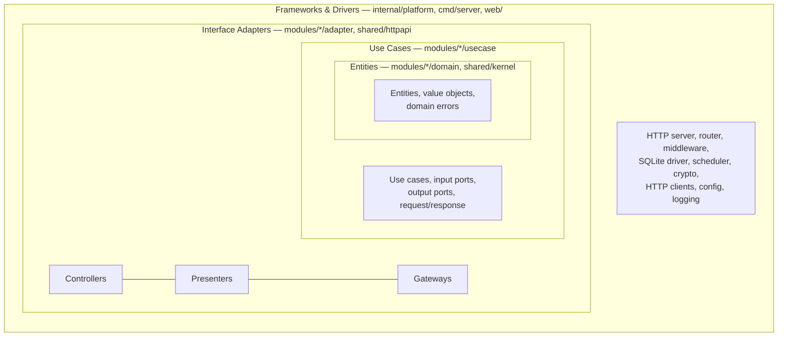
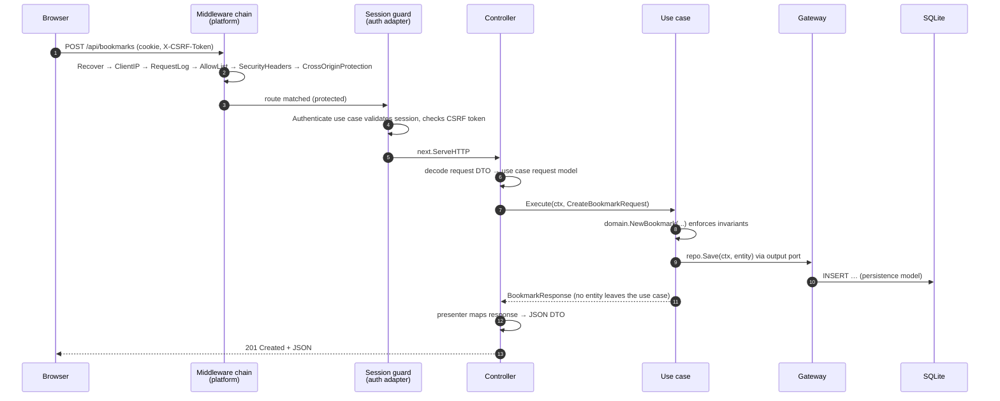

# Architecture

trisse-home is a single Go binary that serves a JSON API and an embedded
Svelte single-page application. Both halves follow Clean Architecture
(see [ADR 0001](adr/0001-clean-architecture.md)).

## The rings



| Ring                 | Packages                                                         | May import                               |
| -------------------- | ---------------------------------------------------------------- | ---------------------------------------- |
| Entities             | `internal/modules/<m>/domain`, `internal/shared/kernel`          | standard library (no I/O), kernel        |
| Use Cases            | `internal/modules/<m>/usecase`                                   | own domain, kernel                       |
| Interface Adapters   | `internal/modules/<m>/adapter/{controller,presenter,gateway}`, `internal/shared/{httpapi,sqlutil}`, `internal/modules` (registry) | own usecase/domain, shared adapter helpers, third-party clients |
| Frameworks & Drivers | `internal/platform/*` (incl. `webui` with the embedded SPA), `cmd/server`                       | everything                               |

**Dependency rule:** source code dependencies point inwards only. No inner
ring knows names, types or functions of an outer ring. Additional rules:

- Modules never import each other. Cross-cutting needs (e.g. the session guard
  of the auth module) are passed in by the composition root as plain
  functions/interfaces.
- Only `module.go` of a module receives platform services (HTTP client,
  cipher, database handle) and passes them to gateways via constructors.
- Interfaces are declared where they are used (output ports in `usecase`,
  small interfaces in gateways), implementations live outside.

### Enforcement

| Tool                      | What it checks                                                     |
| ------------------------- | ------------------------------------------------------------------ |
| `depguard` (`make lint`)  | forbidden imports per ring (e.g. `net/http` in domain/use case, platform in adapters, modules in platform) |
| `internal/archtest`       | precise ring matrix incl. "no imports between modules", "no third-party in inner rings" |
| ESLint `no-restricted-imports` | same layering for `web/src/features/*`                        |

## Module anatomy

```
internal/modules/bookmarks/
├── doc.go                     package documentation
├── module.go                  wiring; implements modules.Module
├── domain/                    entities, value objects, errors (+ table tests)
├── usecase/                   one type per use case, ports.go, models.go (+ tests with fakes)
└── adapter/
    ├── controller/            HTTP handlers, request DTOs (+ httptest tests)
    ├── presenter/             response DTOs and mapping
    └── gateway/               SQLite repositories / API clients, migrations (+ integration tests)
```

Modules implement `modules.Module` (`internal/modules/registry.go`):
`Name`, `Migrations`, `RegisterRoutes`, `Jobs`, `WidgetKinds`. The
composition root (`cmd/server`) constructs every enabled module, applies its
migrations, registers its routes on the router and its jobs on the
scheduler (Registry / Plugin pattern).

## Request flow



Errors flow back the same way: domain errors wrap kinds from
`shared/kernel` (`ErrInvalid`, `ErrNotFound`, …). Only the controller maps
them to HTTP status codes via `httpapi.WriteDomainError`; messages of
unexpected errors never reach the client.

## Background jobs

Integration modules (weather, services, RSS, system, Docker, AdGuard,
calendar) register jobs. The scheduler runs each job once at startup and then
at its interval; results are written to a cache that the HTTP handlers read
(cache-aside, [ADR 0006](adr/0006-background-jobs-cache-aside.md)).

## Frontend

```
web/src/
├── main.ts                    mounts the app
├── app/                       composition root (container.ts), shell, widget registry
├── shared/
│   ├── api-client/            typed fetch client, generated DTO types (tygo)
│   ├── theme/                 design tokens (CSS variables), light/dark
│   └── ui/                    generic components (Modal, …)
└── features/<feature>/
    ├── domain/                types and pure logic (Vitest)
    ├── usecase/               application logic against port interfaces (Vitest with fakes)
    ├── adapter/api/           implements the ports with the HTTP client, maps DTO → domain
    ├── ui/                    Svelte components; only call use cases
    └── index.ts               public API of the feature
```

Widgets are a Strategy: `src/app/widgets.ts` maps a widget kind to its
component, default size and settings editor. Features never import each
other; `src/app` wires them.

## Security layers

1. IP allowlist (`ALLOWED_CIDRS`), proxy headers only from `TRUSTED_PROXIES`.
2. Session cookie (`HttpOnly`, `SameSite=Strict`, optional `Secure`/`__Host-`).
3. CSRF: synchronizer token + `http.CrossOriginProtection`.
4. Login rate limiting, Argon2id password hashing.
5. Strict CSP and security headers; Markdown and feed content is sanitized
   with DOMPurify before rendering.
6. Integration secrets encrypted with AES-256-GCM (`SECRET_KEY`).
7. Docker access only via a read-only socket proxy on an internal network.
