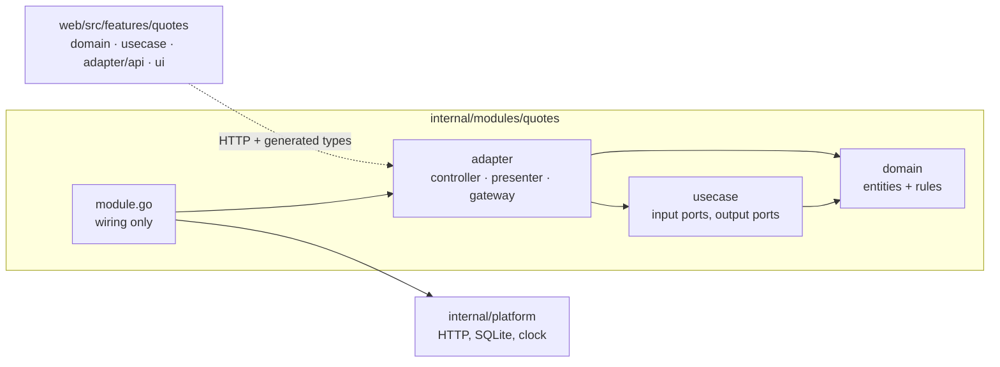

# Developer guide: your own widget in 30 minutes

This guide builds a small but real widget — **quote of the day** — from an
empty checkout to a pull request. Every step names the test that belongs to
it and the command to run. The code below was produced by following this
guide on a fresh clone (tool time about two minutes; reading and typing make
it roughly half an hour).

The rules are enforced by tools (`internal/archtest`, `depguard`, type
checks); this guide explains *why* they exist.

## 0. Setup (≈ 5 min)

```sh
git clone https://github.com/itadori26/trisse-home.git && cd trisse-home
make deps && make ci
```

See [CONTRIBUTING.md](../CONTRIBUTING.md#development-setup-about-10-minutes)
for running the app with hot reload.

## 1. The dependency rule in one picture



Arrows point **inwards**: the domain knows nothing, the use cases know the
domain and *declare* the ports they need (`Repository`, `Clock`), adapters
implement those ports. That is why you can test a use case with an in-memory
fake, swap SQLite for something else, or run the whole app against fixtures
in demo mode — without touching the business rules.

## 2. Scaffold the module (≈ 2 min)

```sh
make new-module NAME=quotes TITLE="Quote of the day"
make ci   # the untouched scaffold is green
```

The generator creates all rings with an example `Item` entity (here: the
quote text in `Title`), a SQLite table, CRUD endpoints, a widget and tests,
and wires it up with files of its own (`cmd/server/module_quotes.go`,
`web/src/app/widgets/quotes.ts`, `web/src/app/services/quotes.ts`, the
`i18n/en.ts` and `de.ts` of the feature, the German backend messages); no
existing file changes. The widget can already add and delete quotes.

## 3. Domain: the rule (≈ 5 min)

The business rule is "a different quote every day, the same one all day".
It is pure logic, so it belongs in the domain and needs no mocks to test.

`internal/modules/quotes/domain/pick.go`:

```go
// PickForDay returns the quote for the given day: every day the next quote,
// the same quote all day long, and the same choice on every device.
func PickForDay(quotes []Item, day time.Time) (Item, bool) {
	if len(quotes) == 0 {
		return Item{}, false
	}
	y, m, d := day.Date()
	days := time.Date(y, m, d, 0, 0, 0, 0, time.UTC).Unix() / 86400
	return quotes[int(days%int64(len(quotes)))], true
}
```

Add a domain error next to the generated one in `domain/item.go`:

```go
// ErrNoQuotes is returned by the quote of the day while the list is empty.
var ErrNoQuotes = kernel.NewPublicError(kernel.ErrNotFound, "Add a quote first.")
```

Test (`domain/pick_test.go`): same quote in the morning and the evening,
another one tomorrow, `false` for an empty list.

```sh
go test ./internal/modules/quotes/domain/
```

`kernel.NewPublicError` wraps an error *kind*; the HTTP layer maps
`ErrNotFound` to 404 and shows the message to the user. The domain never
imports `net/http`.

## 4. Use case: the application flow (≈ 5 min)

Add the method to the input port in `usecase/usecase.go` and implement it
with the ports the use case already has:

```go
	// Today returns the quote of the day.
	Today(ctx context.Context) (domain.Item, error)
```

```go
// Today implements Quotes.
func (u *uc) Today(ctx context.Context) (domain.Item, error) {
	items, err := u.List(ctx)
	if err != nil {
		return domain.Item{}, err
	}
	q, ok := domain.PickForDay(items, u.d.Clock.Now())
	if !ok {
		return domain.Item{}, domain.ErrNoQuotes
	}
	return q, nil
}
```

The time comes from the `kernel.Clock` port, not `time.Now()`, so the test
controls it. Test (`usecase/usecase_test.go`) with the generated in-memory
repository: empty list → `kernel.ErrNotFound`, one quote → that quote.

```sh
go test ./internal/modules/quotes/usecase/
```

## 5. Gateway: storage (≈ 0 min)

Nothing to do: the generated SQLite repository and its migration
(`adapter/gateway/migrations/0001_init.sql`) already store quotes. If you
change the schema, add a new migration file — never edit an applied one —
and extend `adapter/gateway/sqlite_test.go`, which runs against a real
temporary database.

## 6. Controller and route (≈ 3 min)

`adapter/controller/handlers.go`:

```go
// Today handles GET /api/quotes/today.
func (h *Handlers) Today(w http.ResponseWriter, r *http.Request) {
	q, err := h.uc.Today(r.Context())
	if err != nil {
		httpapi.WriteDomainError(w, r, err)
		return
	}
	httpapi.WriteJSON(w, http.StatusOK, presenter.Item(q))
}
```

`module.go` — register the route behind the session guard:

```go
	r.Protected("GET /api/quotes/today", m.handlers.Today)
```

Controllers only translate HTTP ↔ use case; the presenter maps the entity to
a DTO so internal fields never leak. Document the endpoint in
`api/modules/quotes.yaml` (`make openapi` merges and validates the fragments). If you add or change a DTO, run `make generate`: the
TypeScript types in `web/src/shared/api-client/generated/` are generated
from the Go structs, so frontend and backend cannot drift apart.

## 7. Frontend feature (≈ 7 min)

The frontend has the same rings in `web/src/features/quotes/`.

Output port and use case (`usecase/quotesUseCases.ts`):

```ts
  today(): Promise<QuotesItem | null>;      // in QuotesGateway

  /** The quote of the day, or null while there is none. */
  today(): Promise<QuotesItem | null> {     // in QuotesUseCases
    return this.gateway.today();
  }
```

API adapter (`adapter/api/quotesApi.ts`) — a 404 is "no quote yet", not an
error:

```ts
  async today(): Promise<QuotesItem | null> {
    try {
      return toItem(await this.http.get<ItemDTO>('/api/quotes/today'));
    } catch (err) {
      if (err instanceof ApiError && err.status === 404) return null;
      throw err;
    }
  }
```

Widget (`ui/QuotesWidget.svelte`) — load both and show the quote above the
list:

```svelte
  const load = () =>
    Promise.all([quotes.list(), quotes.today()])
      .then(([l, q]) => ((items = l), (today = q), (error = '')))
      .catch((err) => (error = errorMessage(err)));
```

```svelte
{#if today}<blockquote class="today">{today.title}</blockquote>{/if}
```

Add `today: vi.fn()` to the gateway fake in `usecase/quotesUseCases.test.ts`
(the type checker tells you). Every visible text goes through `t('…')` with
keys in `web/src/features/quotes/i18n/en.ts` and `de.ts`.

```sh
cd web && npx svelte-check && npx vitest run src/features/quotes
```

## 8. Registry and the widget picker (≈ 1 min)

The generator already created the widget definition
`web/src/app/widgets/quotes.ts` (`kind`, title, description, default size) and
registered the module in `cmd/server/module_quotes.go`. The backend reports the module's `WidgetKinds()`,
so the widget only appears in the picker when the module is enabled
(`MODULES_DISABLED=quotes` hides it). Once the grouped picker (#104) is in
place, also give the definition a category and an icon.

**Optional: answer in the smart search (#161).** If the module has something worth
asking for ("next waste collection", "speed test"), add
`web/src/app/search/quotes.ts`: `defineSearch({ module: 'quotes', intents, source })`.
Intents are data (weighted terms, optional prefixes and slots), the source wraps
your use cases and returns a text, metric, list, status or action answer. It is
collected by convention, the engine stays untouched. Copy `search/speedtest.ts`
and add a few queries to the table in `search/search.test.ts`.

## 9. Pull request

```sh
make ci && make smoke
git switch -c feat/quotes && git commit -am "feat(quotes): quote of the day widget"
```

Open a PR that says `Closes #<issue>`, fill in the checklist (no new
dependency or a justification, budgets green — see
[ADR 0011](adr/0011-lean-by-default.md)) and describe how you tested it.

## Checklist for a new integration

When the widget talks to another system (see the
[integrations roadmap #91](https://github.com/itadori26/trisse-home/issues/91)):

- [ ] Domain types describe what the widget shows, not the vendor's JSON
- [ ] The use case depends on a provider **port**; the vendor client is a gateway adapter
- [ ] **Opt-in outbound requests:** nothing is contacted until the user saves a URL; timeouts set; results cached in the use case; host listed in the README section *Outbound requests*
- [ ] **Secrets encrypted** through the `Cipher` and only returned as "set / not set"
- [ ] Gateway tested against an `httptest.Server` with recorded responses
- [ ] Category and icon for the widget picker (#104); texts in both catalogues
- [ ] Optional fixture in `internal/platform/demo/transport.go` so the demo shows it
- [ ] Anything that only needs one value from a JSON endpoint can use the generic JSON widget (#48) instead
