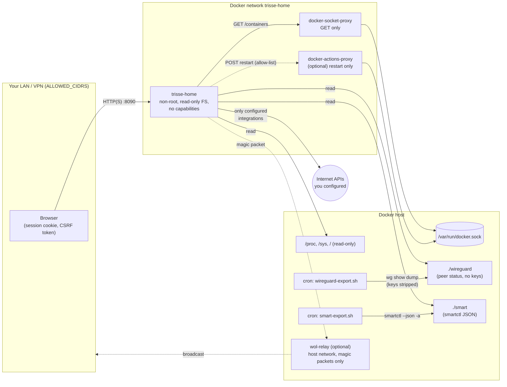

# Security model

trisse-home runs on a home server next to things that matter: the Docker
daemon, the WireGuard VPN, the router. The guiding rule is **least privilege
per component**: the application gets read access to exactly what a widget
shows, and every capability that could change something lives in a separate,
optional, minimal component that you enable on purpose.

This page explains why the optional setups are an extra step and what each
component can and cannot do.

## Trust boundaries

Solid lines are always present, dotted lines only when you enable the
optional component.

| Component | Can | Cannot |
| --- | --- | --- |
| **trisse-home** container | Read container list and stats through the read-only proxy, read host metrics from read-only mounts, read the WireGuard peer and S.M.A.R.T. exports, call the integrations you configured | Write to Docker, read files outside its mounts, gain privileges (non-root, no capabilities, `no-new-privileges`, read-only root FS), be reached from outside `ALLOWED_CIDRS` |
| **docker-socket-proxy** | Forward `GET` requests to the container and image endpoints (plus ping/version); `IMAGES=1` lets trisse-home read the repo digests and labels of the images of running containers for the update hints | Write anything (`POST: 0`) — it cannot pull, delete or build images — read system info, volumes, networks or secrets |
| **docker-actions-proxy** (profile `docker-actions`) | Forward `POST /containers/<name>/stop\|restart\|kill` | Any read, create, exec, image or volume operation; trisse-home itself only calls *restart* for containers on `DOCKER_ACTIONS_CONTAINERS` |
| **wireguard-export.sh** (cron, root) | Run `wg show all dump` and write peer public keys, endpoints, handshakes and traffic | Write private or preshared keys — the interface line is dropped and the PSK column blanked |
| **smart-export.sh** (cron, root) | Run `smartctl --scan-open` and `smartctl --json -a` and write one JSON file per disk | Change disks or read their data — smartctl only reads the health log; the container gets no device access |
| **wol-relay** (profile `wol`) | Accept valid magic packets on UDP 9009 and broadcast them into the LAN, rate-limited | Read data, Docker or secrets; forward anything that is not a magic packet; it has no capabilities and a read-only filesystem |
| **Stored credentials** | Be used by the module they belong to | Be read back through the API or appear in logs: they are encrypted with AES-256-GCM using `SECRET_KEY` and only returned as "set / not set" |

### Integration targets (#191)

AdGuard Home / Pi-hole, Nextcloud, the FRITZ!Box, Speedtest Tracker,
CalDAV calendars and task lists, Proxmox VE, the WebDAV backup target and the
notification channels call an address that **only the signed-in owner**
enters in the settings. These addresses are handled in one place:

- **Validation when saving** (`kernel.ParseTarget`): `http` or `https` with a
  host only; no user name or password in the URL (there are fields for them);
  no query or fragment (webhooks may carry a token in the query); no path
  unless the integration needs one (WebDAV folder, CalDAV collection, a
  Pi-hole or Nextcloud sub path).
- **Address rule, when saving and again for every connection**: loopback and
  private ranges stay allowed because home-lab services live there;
  link-local addresses (`169.254.0.0/16`, `fe80::/10`, including the cloud
  metadata service at `169.254.169.254`), multicast and unspecified addresses
  are refused. The check runs in the dialer on the resolved address, so a
  hostname that later resolves elsewhere cannot get around it.
- **Integration HTTP client** (`httpclient.WithIntegrationGuard`): no
  redirects are followed, no proxy is used, a timeout applies and responses
  are limited to 32 MiB (the WebDAV restore allows a whole backup).
- **Errors**: the browser only sees a generic cause ("not reachable", "did
  not answer in time", "login rejected", …); the technical detail – host,
  port, resolver or TLS message – is written to the log only.
- **Secrets follow their target**: when the address, user name, token ID or
  certificate fingerprint changes, the stored password or token is not
  reused – it has to be entered again, so it is never sent to a new server by
  accident.
- **`http://`** is accepted for LAN devices without TLS (the FRITZ!Box
  TR-064 port only speaks http), but the settings show a warning: the
  password or token then travels unencrypted through your network. Prefer
  `https://` wherever the device supports it, and a pinned certificate
  fingerprint for self-signed certificates (Proxmox VE).

This narrows what a hijacked owner session could reach through the
integrations; it does not change the model that only the owner configures
them.

## Why each optional setup is an extra step

### Docker socket proxy

Whoever can talk to the Docker socket is root on the host: they can start a
privileged container that mounts `/`. Mounting the socket into a web
application would turn every bug in that application into a full host
compromise. The proxy reduces the API to the read endpoints the widget needs.

### Docker actions

Restarting needs `POST`, which the read-only proxy rightly refuses. Instead
of loosening it, a **second** proxy allows nothing but stop/restart/kill and
nothing else — not even reads — and trisse-home adds its own allow-list of
container names on top. Logs are read through the read-only proxy.

### Home Assistant

A long-lived access token can do everything its user can, including unlocking
doors. trisse-home therefore reads states only and calls exactly one service
per entity type (toggle or press), and only for entities that
`SMARTHOME_ACTIONS_ENTITIES` lists in the environment. A browser session cannot
widen that list. Entity types without a safe action, such as locks, alarm
panels and covers, are never switched. Use a dedicated Home Assistant user for
the token so it can be revoked on its own.
### Proxmox VE

The widget only needs to read, so the documented token has the role
`PVEAuditor`. Proxmox serves a self-signed certificate. Instead of switching
TLS verification off, trisse-home pins the certificate's SHA-256 fingerprint
and rejects every other certificate, so a machine in the LAN cannot pose as
the node and catch the token. Start and shutdown need two independent steps:
`PROXMOX_ACTIONS_GUESTS` in the environment (a browser session cannot change it)
and the `VM.PowerMgmt` permission for exactly these guests in Proxmox. A hard
stop is never offered, and every action lands in the security event log.

### DNS filter pause

Pausing AdGuard Home or Pi-hole switches ad and tracker blocking off for
the whole network, so it is off by default. Only the providers listed in
`DNS_PAUSE_PROVIDERS` in the environment can be paused, and a browser session
cannot change that list. A pause always has a timer (5, 30 or 60 minutes), and
the DNS filter switches itself back on. Every pause lands in the security
event log, and the setting is refused together with `DEMO_MODE=true`.

### WireGuard export

`wg` needs `CAP_NET_ADMIN` in the network namespace of the VPN, and its
output contains the server's private key. Giving the dashboard either would
put the whole VPN at risk. A tiny script on the host, run by cron, writes only
the public peer status into a directory that is mounted read-only into
trisse-home. The script is short enough to read in a minute:
[`scripts/wireguard-export.sh`](../scripts/wireguard-export.sh).

### Backup restore

Restoring replaces every piece of data, so `POST /api/backups/restore` is
owner-only (no guests, no API tokens), needs the password and — when enabled —
a fresh 2FA code again (rate-limited and logged like a login), and validates the
file with SQLite's integrity check and the schema version before anything is
replaced. The swap happens on the next start, before the database is opened;
the previous database stays next to it as `trisse-home.db.before-restore`.
Off-site copies go to the WebDAV folder you configure; its password is
encrypted with `SECRET_KEY`. The backups themselves contain your data (secrets
stay encrypted with `SECRET_KEY`, passwords only as hashes), so use a folder only
you can read.

### Prometheus metrics

`GET /metrics` exists only with `METRICS_ENABLED=true`. It needs a bearer
token of at least 32 characters (compared in constant time) and is limited
by `ALLOWED_CIDRS` like every other route. It reveals service, container and
disk names, but no credentials and nothing from your data. See
[metrics.md](metrics.md).

### S.M.A.R.T. export

Reading disk health needs raw device access (`/dev/sd*`, `CAP_SYS_RAWIO`),
which would let a compromised dashboard read every disk. Instead a host
script run by cron writes the JSON output of `smartctl` into a directory that
is mounted read-only into trisse-home:
[`scripts/smart-export.sh`](../scripts/smart-export.sh). The export contains
model and serial numbers and health counters, nothing from the disks' contents.

### Wake-on-LAN relay

Magic packets are broadcasts, and broadcasts do not leave a Docker bridge
network. Putting trisse-home itself into the host network would remove the
network isolation of the whole application. The relay is the only component
in the host network, and it can do exactly one thing: send magic packets —
which any device in your LAN can do anyway.

## FAQ: alternatives and their trade-offs

**Can I run trisse-home in the host network instead of using the relay?**
Yes: set `WOL_RELAY=` (empty). trisse-home then broadcasts itself. The
trade-off: the application can reach every service bound to `localhost` on
the host and loses the network isolation of its own Docker network.

**Can I avoid the extra container for Wake-on-LAN altogether?**
Enable directed broadcast forwarding on the host
(`net.ipv4.conf.all.bc_forwarding=1` and the same for your LAN interface),
set `WOL_RELAY=` and `WOL_BROADCAST=<lan>.255:9`. The trade-off: a host-wide
kernel setting that also affects every other container.

**Why not mount the Docker socket read-only (`:ro`)?**
`:ro` only prevents replacing the socket file; the API behind it is fully
writable. It gives no protection.

**Why not give the container `CAP_NET_ADMIN` for WireGuard?**
The capability is not limited to WireGuard: it allows changing routes,
firewall rules and interfaces of that network namespace. The export script
needs no change to the container at all.

**Can I expose trisse-home to the internet?**
It is designed for the LAN or a VPN. If you must, put it behind a reverse
proxy with HTTPS, set `COOKIE_SECURE=true`, `TRUSTED_PROXIES` and a strict
`ALLOWED_CIDRS`, and enable two-factor authentication. Never forward the port
in your router directly. See [reverse-proxy.md](reverse-proxy.md).

**What leaves my network?**
Only requests to services you configured (weather location, feeds, CalDAV,
DHL, …), each listed in the README section *Outbound requests*. There is no
telemetry; the update check is off by default.

## Reporting vulnerabilities

See [SECURITY.md](../SECURITY.md).
